<p align="center"></p>

# Steward — local-first personal agent for macOS

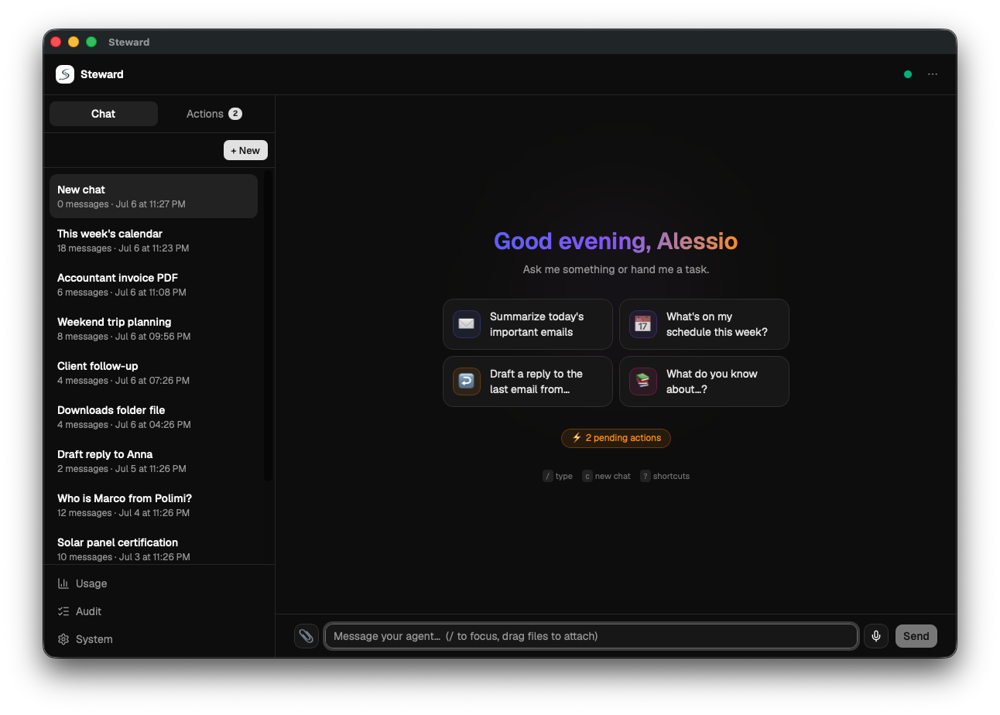

Steward is a **personal AI assistant that runs on your Mac**. It can chat with you, read your personal knowledge base, search Apple Mail, Calendar, Contacts and local files, prepare actions such as email replies or calendar events, and ask for your approval before doing anything sensitive.

The simplest way to describe it is:

> Steward is a private assistant with memory. It keeps a local wiki about your work and life, watches for useful signals in your mail and calendar, and turns them into searchable knowledge or ready-to-approve actions.

The technical way to describe it is:

> Steward is a local-first agent platform made of a React/PWA client, a Node host running a Pi-based agent, MCP connectors for local data sources, a self-hosted OpenAI-compatible LLM gateway, background indexing/distillation jobs, and a vendored LLM Wiki desktop app used as long-term inspectable memory.

The host, local connectors and primary stores run on your Mac. Chat context sent to a remote model leaves the machine through the configured gateway. LLM Wiki has its own provider settings and optional network features: web research, MinerU cloud parsing and Git vault backup can contact other services. Train lookups contact ViaggiaTreno; phone access and notifications use Tailscale/Web Push, and optional calls use SIP/Ringback. “Local-first” describes ownership and runtime placement, not an enforced network-egress allow-list.

> `apps/llm-wiki` is a vendored fork of the LLM Wiki desktop app. The surrounding Steward host, web UI, connectors, scheduler, gateway, launcher, approval system, mobile access, and automation layer are original to this repo.

## Reading Guide

- [What Steward Does](#what-steward-does) — product-level capabilities and examples.
- [Main Workflows](#main-workflows) — the user-visible chat, memory, Action Center, mobile, usage and audit experiences.
- [Voice And Quick Send](#voice-and-quick-send) — authenticated phone entry points, speech settings and the Ringback transport.
- [Live Trains And Event Monitors](#live-trains-and-event-monitors) — live Italian train data and reusable background notifications.
- [System Health And Tool Inventory](#system-health-and-tool-inventory) — live service checks, background-job diagnostics and tool-policy visibility.
- [Architecture](#architecture) — services and the three operating planes.
- [End-To-End Data Journeys](#end-to-end-data-journeys) — complete chat, mail ingestion, threading, embedding and wiki-promotion flows.
- [Retrieval Internals](#retrieval-internals) — mail, calendar, contacts, wiki and local-file search algorithms, Calendar write transport/identity and bounded document reads.
- [Approval And Write Reliability](#approval-and-write-reliability) — tool policy, human approval, journaling, confirmation and retry.
- [Proactive And Background Processing](#proactive-and-background-processing) — Action Center, scheduler consistency and gateway routing.
- [Data Ownership And Rebuildability](#data-ownership-and-rebuildability) — authoritative stores, index identity state and backup boundaries.
- [Failure Modes And Graceful Degradation](#failure-modes-and-graceful-degradation) — behavior when permissions, models or local services are unavailable.
- [Performance, Bounding And Backpressure](#performance-bounding-and-backpressure) — the limits that keep large local datasets and background work predictable.
- [Trust Boundaries And Threat Model](#trust-boundaries-and-threat-model) — enforced guarantees and explicit non-goals.
- [Engineering Decisions And Trade-Offs](#engineering-decisions-and-trade-offs) — why the system uses mirrors, SQLite, hybrid retrieval and deterministic policy.
- [Setup](#setup) — prerequisites, development, launcher, packaging and rollback-safe native deployment.

## What Steward Does

### For a non-technical user

Steward gives you one place to ask questions and approve actions.

You can ask things like:

- "Find the invoice PDF the accountant sent me last month."
- "Reply to Anna and say Friday afternoon works."
- "Am I free Thursday between 14:00 and 17:00?"
- "What did we decide about the solar-panel certification?"
- "Show me the latest file in Downloads and attach it to an email."
- "Remind me what this client asked for in the last thread."
- "Qual è il prossimo treno da Milano Rogoredo a Bologna e da che binario parte?"
- "Avvisami quando parte, quando manca una fermata e quando devo scendere."

Steward can then:

- search your email, attachments, contacts, calendar, local files and wiki;
- explain what it found;
- show rich cards for emails, files, events and search results;
- prepare an email, reply, scheduled email, calendar event or file operation;
- show an approval card before a write happens;
- let you approve, edit, deny, or ask for a revised proposal;
- keep a background Action Center of things that may need your attention;
- notify your phone when there is an action waiting for you;
- look up live Italian trains and notify you as their state changes;
- keep a personal wiki of durable facts, decisions, commitments and source links.

Interactive sensitive tools require host-mediated approval. An explicitly approved agent watch may later perform its constrained actions without a new card for each event. Background wiki promotion and indexing also write local state under their configured automation rules; approval of every filesystem write is not a platform-wide guarantee.

### For a technical user

Steward is a monorepo of local services:

- `apps/web` is the browser/PWA client.
- `apps/host` serves the web app, owns sessions, runs the agent, gates tools, stores chat history, exposes usage/system routes, and bridges UI events over WebSocket.
- `apps/llm-gateway` exposes one OpenAI-compatible endpoint with model capability tiers.
- MCP servers expose Mail, Calendar, Contacts, Documents, Shell, Trains, LLM Wiki and Action Center tools.
- `apps/scheduler` runs periodic background jobs.
- local SQLite stores mirror mail, calendar/contact indexes, action items, write-operation journals, chats and usage.
- `apps/mac-launcher` packages all of this as a menu-bar macOS app.

The agent uses MCP tools through `packages/mcp-bridge`. Tool calls are classified as allowed, gated or denied. The interactive default is `gate`; known safe tools are explicitly allowed and denied prefixes are blocked. Sensitive operations normally become approval cards; approved watch grants provide a separate constrained future authority.

## Main Workflows

### Chat With Local Context

The chat UI is not a generic chatbot. It is connected to local tools:

- LLM Wiki tools for long-term memory and source-backed knowledge.
- Mail tools for search, reading threads, opening `message://` links, saving attachments, sending, replying and scheduling emails.
- Calendar tools for availability checks, search and event CRUD.
- Contacts tools for resolving people from names, emails and AddressBook records.
- Shell tools for safe file discovery and read-only command execution.
- Action Center tools for inspecting and executing pending proposed work.
- Train tools for live direct-train lookup, status refresh and platform confidence.
- Generic watch tools for persistent, event-driven notifications composed by the agent.

Messages stream in the UI. Tool calls appear as visible cards, including status, inputs, outputs, duration and errors. The transcript can be copied as JSON for debugging.

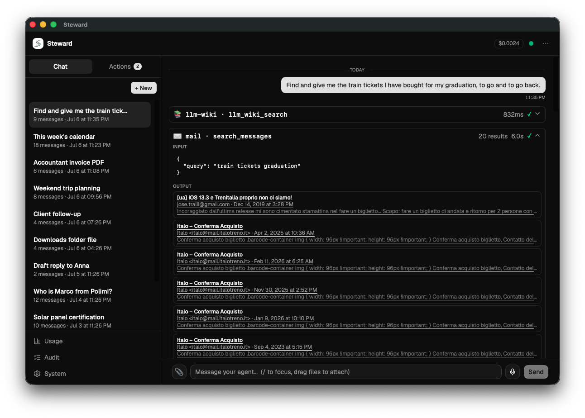

Rich results — emails, files, events — render as cards instead of raw text:

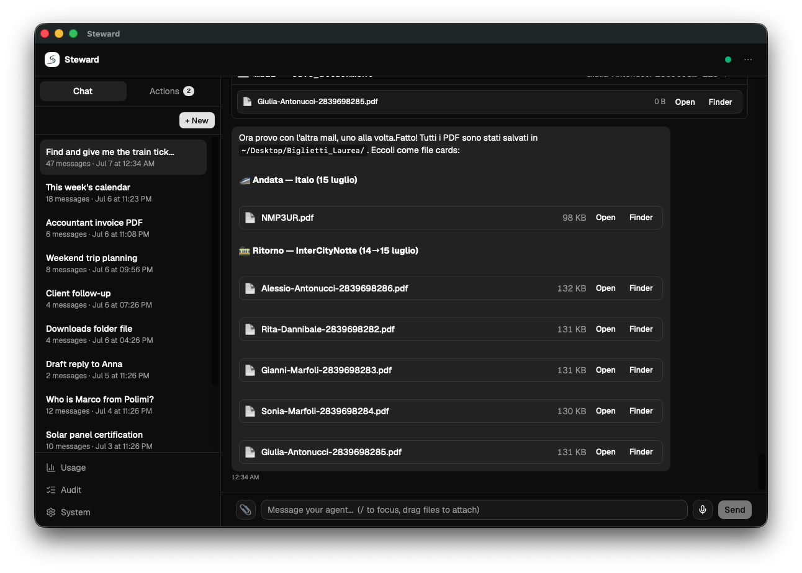

### Approval Cards

When the agent wants to perform a sensitive operation, the host turns the request into an approval card.

Examples of gated actions:

- send an email;
- reply to a thread;
- send an email later;
- create, update or delete a calendar event;
- write to the clipboard;
- run a file-mutating shell command;
- execute an Action Center proposal.

Approval cards support:

- approve;
- approve with edits;
- deny with note;
- request revision.

This means the model can suggest an action, but deterministic host code decides whether it can run.

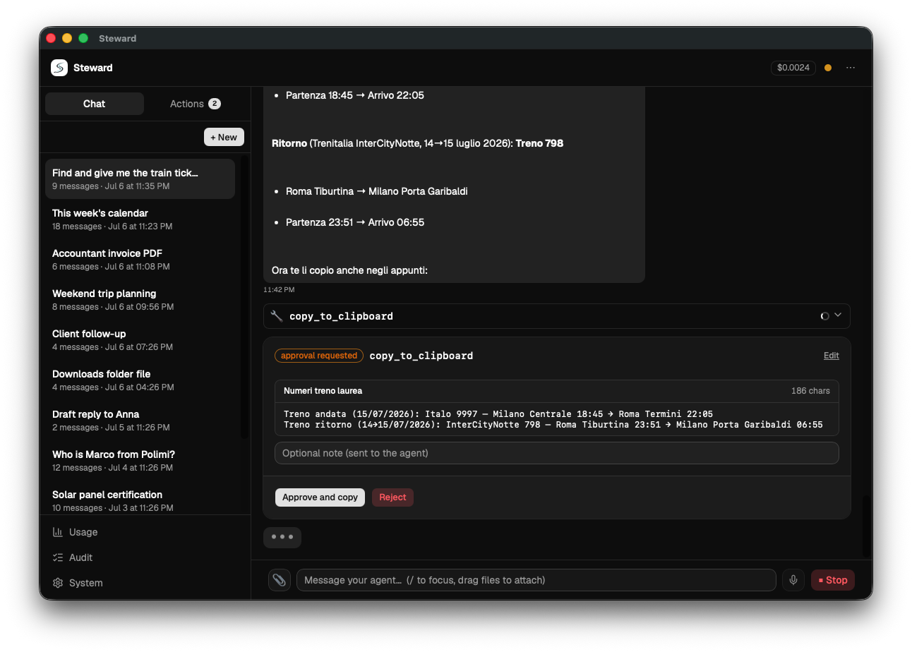

### Action Center

The Action Center is a background inbox of work Steward thinks may need you.

The scheduler scans recent mail and creates action items such as:

- reply-needed email threads;
- scheduling requests;
- follow-ups;
- proposed email responses;
- calendar proposals;
- items that should be reviewed or dismissed.

Each item stores the source thread, summary, status, proposed steps and diagnostics. The web UI shows open items by default and offers independent flags for including completed/dismissed items and hiding items whose `dueAt` is already past; undated items remain visible. Both flags persist in browser `localStorage` (`steward.actions.showDone` and `steward.actions.hideExpired`) and are reapplied on the first connection and every reconnect. Filtering is performed in SQLite before the result limit. Action state exposes both `countsTotal` and filter-aware `countsVisible`; the legacy `counts` field remains an alias for totals. Badges use the visible count, while status cards show `visible/total` when the values differ. Selecting an item marks it read, opens the detail pane, and lets the agent refine or execute the proposal through the same approval flow used in chat.

The `list_actions` MCP tool returns compact summaries unless `includePayload` is explicitly requested. Its JSON schema declares a range of 1–100 items, and `ActionStore.list()` independently clamps direct callers to the same hard maximum. This defence in depth prevents a model—or another internal caller—from materializing thousands of large context snapshots in memory or in the agent context. Full detail for one item remains available through `read_action`.

Steward also supports explicit, reusable **flows** for personal procedures that the model could not reliably infer on its own. Ask in chat to create a flow from the steps you just described; Steward presents a dedicated approval card where you can edit its name, triggering situation, guidance and exclusions before saving it. Flows are never learned silently and never execute writes automatically. They can be listed, searched, updated, disabled or deleted through the Action Center tools.

Action generation can be disabled from the System page without stopping the rest of Steward. The global `enabled` setting stops both mail and calendar scans; re-enabling sets `enabledAt`, which filters mail by ingestion time and calendar entries by modification time. A separate `calendarEnabled` setting suppresses only Calendar reminders; re-enabling it records `calendarEnabledAt`. Calendar uses the later of its own and the global cutoff. Existing Actions remain available.

Calendar reminders are deterministic, not LLM plans: indexed non-cancelled events starting within the next three days (`ACTION_CENTER_CALENDAR_DAYS`) produce `event-reminder` items, with high priority within 24 hours and normal priority afterwards. Their source key combines event UID and start instant. Calendar availability and index freshness therefore affect reminder generation independently from mail planning.

`GET`/`POST /settings/actions` expose these controls plus `textLanguage` (`default`, `en`, `it`), stored in Action Center metadata. The language preference guides newly generated display titles, summaries, proposal and step labels, and revised summaries. It does not bulk-translate existing items or authorize translation of tool arguments, source identifiers, email drafts or calendar content. `default` omits an LLM language directive; the deterministic calendar renderer currently uses English title labels with Italian date formatting. See [Action settings and Calendar reminders](#action-settings-and-calendar-reminders) for the processing contract.

The Action Center sends Web Push notifications to paired phones when a new Action is created, in addition to notifications associated with chat responses and pending approvals. Notifications route to the relevant Action/chat through a validated payload in an existing window or URL parameters in a newly opened window. The app consumes those parameters once and waits for an authenticated host connection before selecting the destination. A notification is marked dispatched only when no subscription exists or at least one registered endpoint accepts it; if all endpoints fail, the Action remains eligible for a later retry. Expired subscriptions returning HTTP 404/410 are pruned without treating successful deliveries to other devices as failures.

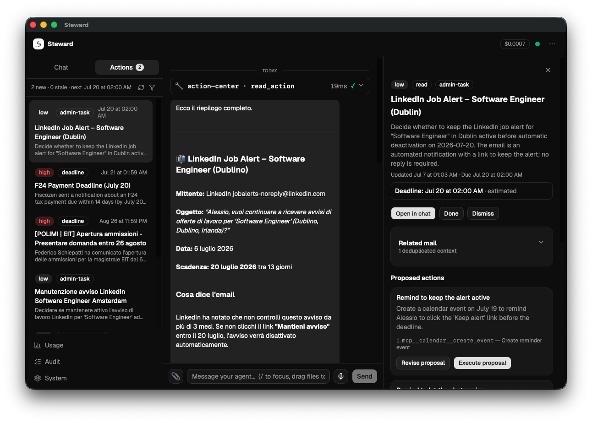

### Personal Wiki Memory

Steward uses LLM Wiki as durable memory. Instead of only retrieving raw documents at answer time, the wiki incrementally turns sources into Markdown pages that can be inspected, edited and searched.

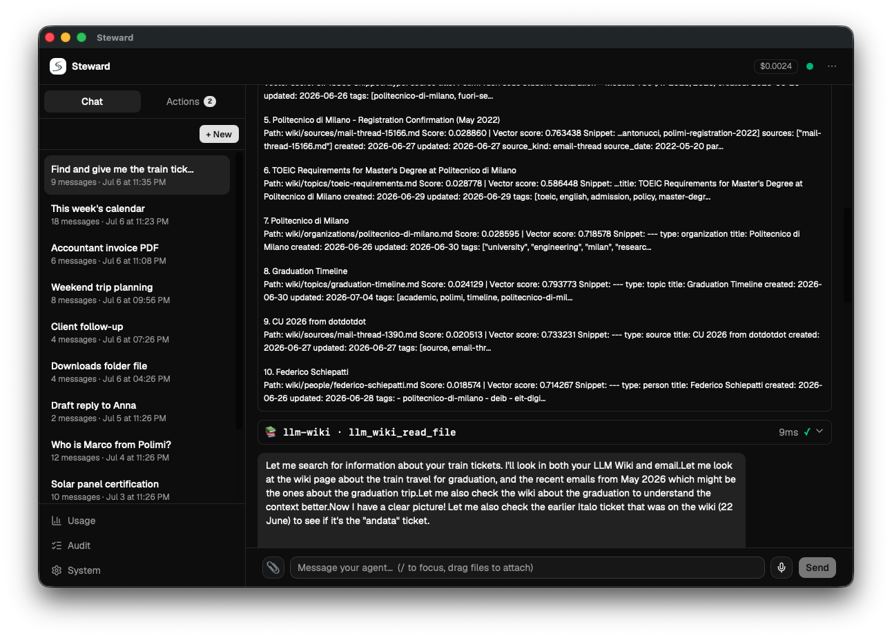

The wiki keeps:

- raw sources;
- generated wiki pages;
- `index.md` as a catalog;
- `log.md` as an operation trail;
- `purpose.md` to describe why the wiki exists;
- `schema.md` to define page rules and structure;
- YAML frontmatter with source traceability;
- Obsidian-compatible `[[wikilinks]]`;
- graph relationships between pages.

The LLM Wiki fork includes:

- desktop Tauri app;
- project templates;
- two-step ingest;
- persistent ingest queue;
- folder import;
- source folder auto-watch;
- multimodal image extraction and captioning;
- optional MinerU PDF parsing;
- vector semantic search;
- graph visualization;
- Louvain community detection;
- graph insights and Deep Research;
- lint/review flows;
- Chrome web clipper;
- local HTTP API on `127.0.0.1:19828`;
- bundled MCP server for external agents.

Steward also has `apps/wiki-add`, a small CLI and Finder Quick Actions helper for adding files or folders into the wiki.

### Mail Mirror And Mail Promotion

Steward does not ask Apple Mail to search everything live each time. It maintains a local mirror.

`apps/mail-mirror` reads Apple Mail's on-disk `.emlx` store and builds:

- SQLite message/thread tables;
- full-body records where locally available;
- soft-delete tracking;
- thread resolution;
- attachment blob storage;
- trigram keyword indexes;
- vector indexes through sqlite-vec;
- embedding state;
- mailbox role classification;
- fallback AppleScript reads for non-full messages with insufficient mirrored text.

`apps/mail-promoter` then scans mail threads and promotes durable knowledge into the wiki. It filters noise, extracts decisions, commitments, facts, useful documents and selected attachments, then writes source notes with `message://` backlinks so you can inspect the original email.

### Calendar And Contacts

Calendar and Contacts are also indexed locally.

`apps/calendar-mcp` reads Apple's Calendar database and builds a searchable index. Approved writes use the launcher's EventKit bridge when configured and representable; AppleScript remains a compatibility path. Full Disk Access for database reads, Calendar Full Access for EventKit and Calendar Automation for the compatibility path are distinct permissions.

`apps/contacts-mcp` reads AddressBook data, deduplicates people, labels fields, supports hybrid search, and exposes `resolve_recipient` so the agent can turn "Marco" or "Anna from Polimi" into the right address before proposing an email.

### Local Files And Shell

`apps/shell-mcp` gives the agent constrained access to the filesystem.

It supports:

- finding files;
- read-only command execution;
- gated write commands.

The read-only command runner accepts familiar shell-like syntax including pipes, but it does not spawn a real shell. It parses the command itself, uses allow-listed binaries with explicit argv, and rejects dangerous constructs such as command substitution and redirection. Sensitive paths are blocked by shared path policy.

`apps/documents-mcp` reads attached or discovered PDF, Markdown, text/data, HTML, RTF, DOCX, PPTX and ODT files. Reads are cursor-paginated with hard output limits. Targeted questions use bounded lexical and semantic search, with ranking fusion and in-memory extraction/vector caching, so the agent does not need to load a whole long document into context.

### Mobile Access

Steward can be used from a phone without exposing your Mac to the public internet.

The intended setup is:

- Tailscale connects the Mac and phone on a private network.
- The host keeps plain HTTP on localhost and can expose an HTTPS listener on all interfaces when `STEWARD_TLS_CERT` and `STEWARD_TLS_KEY` are configured, for example with a Tailscale certificate.
- The web UI is installed as a PWA.
- A shared auth token pairs the phone.
- Web Push uses VAPID keys generated by the host.
- Push notifications can open directly to a pending action.

The Mac remains the agent runtime. The phone is only a client. See [docs/mobile-access.md](docs/mobile-access.md).

The same PWA, on an iPhone, over Tailscale:

<p float="left">
  
  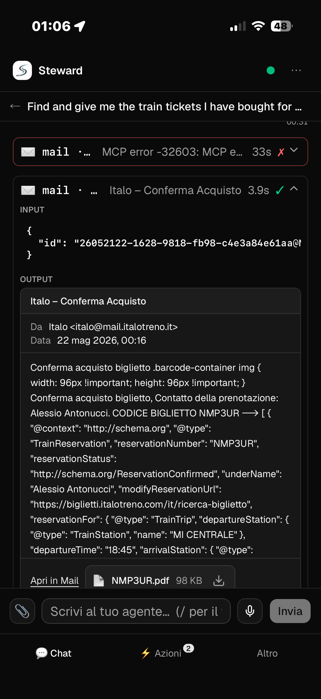
  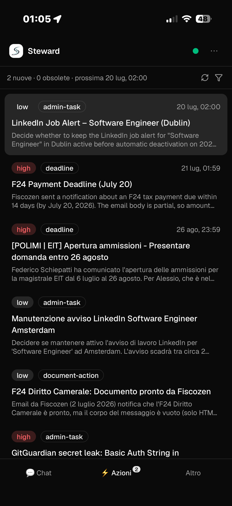
  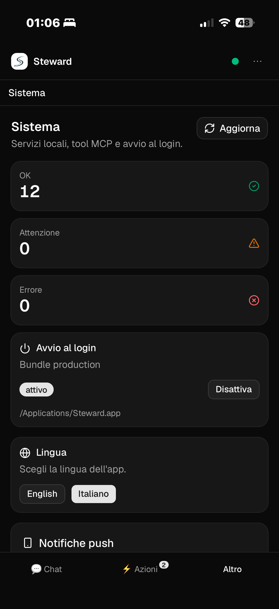
</p>

### Voice And Quick Send

The web app includes microphone recording and transcription support.

The host can transcribe uploaded audio through local `whisper.cpp` when configured with:

- `STEWARD_WHISPER_BIN`;
- `STEWARD_WHISPER_MODEL`;
- `STEWARD_SPEECH_LANGUAGE`;
- optional timeout variables.

`STEWARD_SPEECH_LANGUAGE` falls back to `en`. Set it explicitly to `it` in
`apps/host/.env` during development or in
`~/Library/Application Support/Steward/config.env` for the packaged app. The
repository's `.env.example` shows the Italian setting. The macOS bundle includes
the Whisper runtime and model; the launcher passes the configured language to
`whisper.cpp` with `-l`.

There is also a `/quick-send` path for shortcuts such as an iPhone Action Button. It can send text or audio into a headless chat runner. Gated writes still require approval; unattended sensitive actions time out rather than silently executing. The underlying `ChatManager.runTurn()` returns a discriminated result: success includes the persisted assistant `messageId` and text, while failure includes the error and whether generation was aborted. The WebSocket UI continues to stream events, but Quick Send can now decide whether to send a reply or failure notification without searching the chat transcript and guessing whether the turn succeeded.

`POST /quick-call` is the zero-text companion for an iPhone Shortcut. It
accepts an empty JSON body or an optional `requestId`, always creates a fresh
chat and immediately starts Ringback with the configured opening line. The
advanced `/voice/call` route remains available when the caller needs to supply
a custom opening line.

Optional voice calls use a transport-neutral `/voice/call` channel. The first
adapter is Ringback over SIP/Linphone; it runs as an external MCP process and
keeps the existing Steward agent, memory, tools, audit trail, and approval
boundary. The coordinator already reserves a StreamCore transport for a future
streaming WebRTC media path. See [Voice calls](docs/voice-calls.md).

Ringback is deliberately outside the packaged `.app`: Steward pins and patches
its runtime, but does not silently redistribute pjproject/pjsua2 inside the app
bundle. The managed launcher keeps the MCP stdio pipe open, enforces one native
ARM runtime with a PID/lock directory, terminates the child with the host,
rotates the detailed SIP log, and exposes `--doctor`, `--version`, and `--stop`.
The SIP identity is stored in `voice.env`; the password is read at runtime from
macOS Keychain and is never passed in argv or persisted in that file.

The System page selects an independent installed macOS `say` voice for English
and Italian plus a 100–300 WPM speech rate. `Automatic` chooses a suitable voice
for the current Steward language. Preview audio is rendered to an isolated
temporary WAV and streamed back to the browser; the temporary directory is
removed afterwards. During a call, the agent can change only that call's rate
without approval. Persisting a new default is a normal gated action and uses
the same spoken approval protocol as every other sensitive tool.

### Live Trains And Event Monitors

`apps/train-mcp` reads live Italian railway data from ViaggiaTreno and exposes
two read-only MCP tools:

- `mcp__trains__find_next_train` finds the next direct train in the current
  departure-board window and returns an opaque `trainRef`, route stops,
  scheduled and estimated times, delay, cancellation state and departure
  platform;
- `mcp__trains__train_status` refreshes that same train through its `trainRef`.

Platform confidence is explicit: `confirmed` means an effective platform was
published, `scheduled` means it is only programmed, and `unknown` means it has
not been communicated. The agent is instructed never to present a programmed
platform as confirmed. This connector is a live direct-train lookup, not a
connection planner or ticketing API. It consumes ViaggiaTreno's JSON endpoints
rather than scraping HTML; those endpoints are not treated as a contractual
public API, so failures remain explicit and isolated inside the connector.

Station resolution is designed for voice dictation. It first tries the supplied
name, then—only if autocomplete returns nothing—broadens the query with token
and prefix candidates and ranks the results using normalized edit/trigram
similarity. Ambiguous matches are returned to the agent for clarification. The
resolver is stateless: it does not load habitual stations, LLM Wiki memory or
other personal context.

Background monitoring is intentionally domain-independent. The host-native
`create_watch` tool stores a resource reference, the user's instruction and a
set of semantic event rules; `stop_watch` stops it. Both are automatically
allowed because they only observe or reduce background work. A source adapter
turns snapshot changes into domain events, and matching events are placed in a
durable SQLite queue. The event resumes the persisted agent session of the
originating chat, where the agent can use read-only tools to refresh facts.
`create_agent_watch` adds narrowly constrained grants to individual rules and
therefore requires the normal approval gate. Its generic capability registry
currently covers voice, mail send/reply, calendar create/update/delete,
Contacts create/update and Action Center status changes. Each argument uses an
`exact`, trusted `template`, `one_of`, numeric `range`, or `relative_time`
constraint. Relative times resolve only a registered `state.*` or `event.*`
timestamp plus a fixed minute offset, then freeze to an exact ISO instant before
execution. Extra fields are denied, the runtime enables only tools granted by
the rules matched by that event, and a durable claim prevents repeated
execution. New write tools remain unavailable until their argument surface is
explicitly registered.

These turns retain the conversation's read-only train, calendar, mail and
memory tools. If generation or calling fails, a deterministic fallback push is
delivered.

The `time` adapter handles one-shot `time.reached` events for requests such as
“call me today at 09:00”. Relative requests use `afterMinutes`. Absolute input
uses the same convention as Calendar: an RFC 3339 instant with an explicit UTC
offset, normalized to UTC internally and rendered in the Mac's local timezone
with the date-specific offset. Relative delays are converted to an absolute
instant before the approval request is shown, so time spent deciding on a gated
future action cannot move its deadline. A rule may also declare a bounded
continuation: selected structured action outcomes schedule a durable child time
watch after `afterMinutes`, up to `maxAttempts`. The child inherits the exact
grants and event context; it cannot change tools or widen arguments.

The train adapter currently emits platform announcement/confirmation/change,
departure, arrival, cancellation, delay/ETA change and per-stop
arrival/departure events. Stop-event rules require a selector: `where.station`, stable `where.stationId` or numeric `where.positionRelativeToDestination`. Unfiltered stop rules are rejected; notifications for every stop need explicit route-stop rules. Named-stop selectors are validated against the current route at creation; a
separate watcher observes a different downstream stop without mutating the
opaque `trainRef`. For relative stop rules, `positionRelativeToDestination: -1`
means the stop immediately before the requested destination and `0` means the
destination itself. A generic `before_time` trigger can fire relative to a live timestamp,
such as 30 minutes before `estimatedArrivalMs`; a moving train ETA therefore
moves the deadline until the rule fires. Rules can be one-shot, watches expire
automatically after the journey, and event keys prevent duplicate delivery
across restarts. Future domains can
reuse the engine by registering another adapter rather than adding another
train-specific scheduler.

### Usage & Cost

Host chat and the default service embedding/analysis paths use `apps/llm-gateway`, which records one terminal row per gateway request in `packages/usage-ledger`. Provider fallback attempts are not individually billed in that ledger. Calls made through independently configured wiki providers, overridden direct endpoints or local-model replay are outside this gateway accounting. Callers attribute their own spend with `x-usage-service` / `x-usage-action` HTTP headers; a call that forgets to label itself is recorded as `unknown` rather than silently disappearing, and the Usage page calls that out explicitly so unlabeled spend never goes unnoticed.

Non-interactive work is attributed separately from WebSocket chat. Quick Send
uses `host / quick-send`, resumed watch turns use
`host / watch-agent-turn`, and Action Center distinguishes scans,
proposal revisions, flow indexing and flow retrieval. Non-LLM operations use
the same tool ledger: watch polling/delivery, approval-preview lookups,
planner-selected background reads and directly executed Action steps all record
duration and success/failure instead of disappearing behind their parent job.

The web UI's **Usage** page is the observability view over that ledger: total cost and tokens for the selected period (7 days, 30 days or all-time), cost broken down by service, by action, by day, by model and by token type (input/output/cache read/cache write), plus per-tool call counts, error counts and timing (average/max/total), and a table of the most recent calls. Cost figures combine recorded token counts with the gateway’s `/rates` table. That endpoint serves rates configured in gateway code; it does not fetch provider prices automatically. Editing and restarting the gateway can therefore change displayed historical estimates without re-ingesting tokens. This is usage estimation, not a provider invoice.

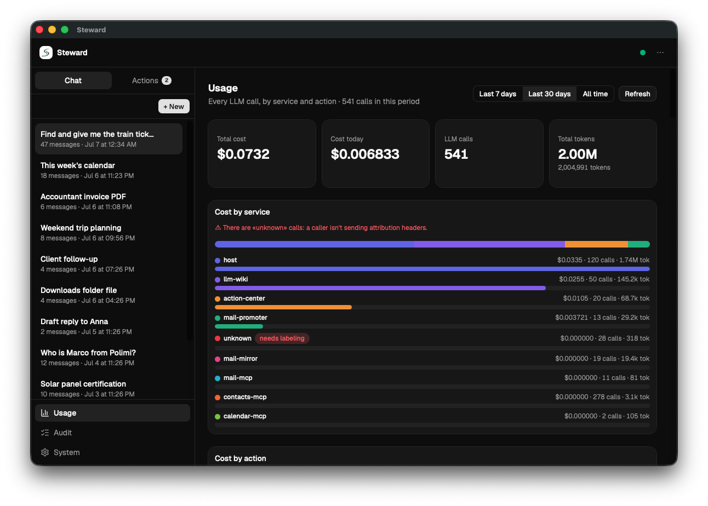

### Audit Trail

Steward keeps a redacted, queryable audit log of what happened across chat, tools, approvals and write operations.

`packages/audit-log` is a shared SQLite ledger. It records:

- user and assistant chat messages;
- tool policy decisions (allow/gate/deny) and their results;
- approval requests and responses, including timeouts;
- write-operation lifecycle (started, confirmed, retried, failed);
- Action Center item creation, execution and revision, including background items created by the scheduler;
- Action Center background reads, approval-preview lookups, flow provenance,
  proposal-notification dispatch and direct tool execution;
- Quick Send creation, structured turn failures and notification dispatch;
- watch creation, stopping, expiry, completion, polling failures, queued events,
  notification generation, retries, fallback and final delivery;
- mail-to-wiki promotion writes;
- session, file and system events (connect, upload, open, autostart, ...).

Audit payload redaction runs before insertion: both payload columns contain the same redacted representation. Secret-like key names are replaced; selected full-text keys (`body`, `bodytext`, `html`, `htmlbody`, `content`, `markdown`) become 120-character snippets. Other strings are bounded to 600 characters. Bearer/`sk-` patterns, URL credentials and sensitive query parameters, common inline secret assignments and PEM private keys are masked before snippets are produced; arrays, object keys and nesting are also capped.

This is a heuristic, not universal secret detection. Event summaries and source references also pass through string redaction before storage; unrecognized secret formats or arbitrary sensitive prose can still retain excerpts. Audit is best-effort and failures do not block product work, so it is not a guaranteed complete forensic ledger. These rules do not redact the primary chat transcript, operational journal, wiki or uploads.

The host exposes the ledger at `/audit` (filterable by actor, event type, risk, chat, tool, date range or free text). The web UI has an **Audit** page — reachable from the desktop sidebar footer and the mobile bottom-nav's "Altro" overflow — with a filterable timeline and a per-event detail view showing the redacted payload and any linked files/sources.

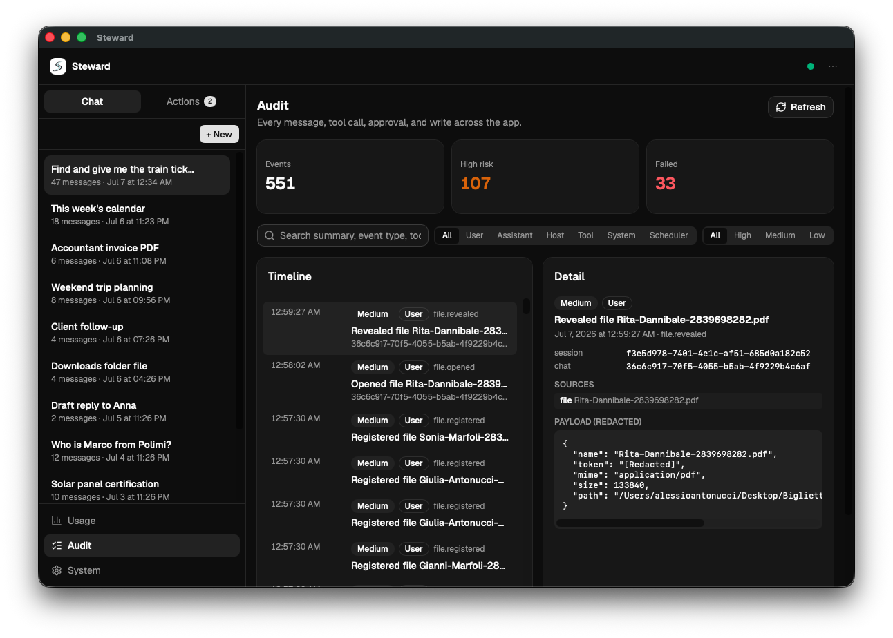

### System Health And Tool Inventory

The System page is an active diagnostic surface, not a static list of configured
services. `GET /system/status` builds one bounded snapshot in parallel from:

- HTTP probes for the host, gateway, Ollama and LLM Wiki;
- gateway model discovery and presence of the local `bge-m3` embedding model;
- scheduler log-tail inspection, including the last known result of each job;
- local speech configuration, watch-store activity and the last watch poll and
  delivery observed by this host process;
- Web Push subscriptions and the most recent per-endpoint delivery report;
- voice state and existence of Ringback's configured Whisper model, without
  spawning a second Ringback process;
- readability/writability of primary SQLite stores, available disk space and
  macOS Mail/Calendar data access;
- a fresh MCP `tools/list` plus a harmless connector-specific smoke call where
  one is defined.

Each MCP tool is shown with its fully qualified name, source, scope
(`chat`/`call`/`watch`/`all`), current deterministic policy decision, call/error
totals and most recent result from the Usage ledger. Discovery is cached and
combined with a bundled manifest: if an MCP server is temporarily down, the UI
keeps its tool inventory visible and marks the service unavailable instead of
making the tools disappear. Native host tools such as `create_watch`,
`create_agent_watch`, `stop_watch`, `ask_user` and the call-only speech-rate
tool are reported through the same model.

Health is intentionally observational. Probes have short timeouts, close their
temporary MCP clients, and never start an external action. State transitions
between `ok`, `warning`, `error` and `unknown` are written to Audit only when
the state changes. Scheduler and watch checks distinguish “not observed in this
process” from a verified failure, avoiding false certainty after startup.

The native launcher complements this runtime view with supervised child processes and a localized AppKit
startup overlay. It reports the Ollama, gateway, wiki, host and web-loading
stages while the WebKit view remains hidden underneath, degrades non-critical
embedding failures to warnings, and offers a retry only for terminal repository
or navigation failures. The overlay is removed with a short fade only after a
real page finishes loading, avoiding both a blank window and an HTML placeholder
that would replace the actual navigation state.

## Architecture

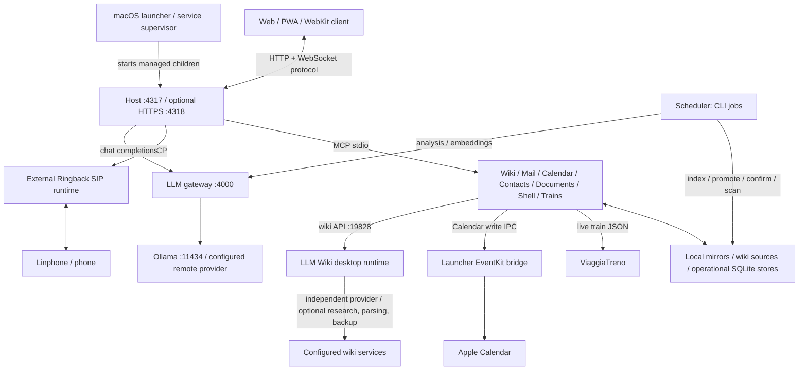


There are three operating planes:

1. **Interactive plane** — the user chats in the web UI; the host runs an agent and exposes tools through MCP. Read actions can run directly. Writes become approval cards.
2. **Background plane** — the scheduler keeps local indexes fresh, embeds mail, distills durable knowledge into the wiki, scans for action items and confirms write operations; the host watch engine polls active resource monitors and delivers matching events.
3. **Reliability plane** — mail/calendar writes are journaled before execution and checked against local mirrors. Watch actions use durable claims and temporary network-route changes use a recovery journal. These mechanisms bound retries and preserve evidence; they do not make an external AppleScript or EventKit effect atomic with a Steward database commit.

## End-To-End Data Journeys

The component diagram explains where code lives; the following walkthroughs explain how data actually moves through Steward. The system is deliberately **eventually consistent**: a new email can become lexically searchable before it has an embedding, and it can be searchable before the mail-to-wiki or Action Center pipelines have evaluated it.

### A Complete Interactive Chat Turn

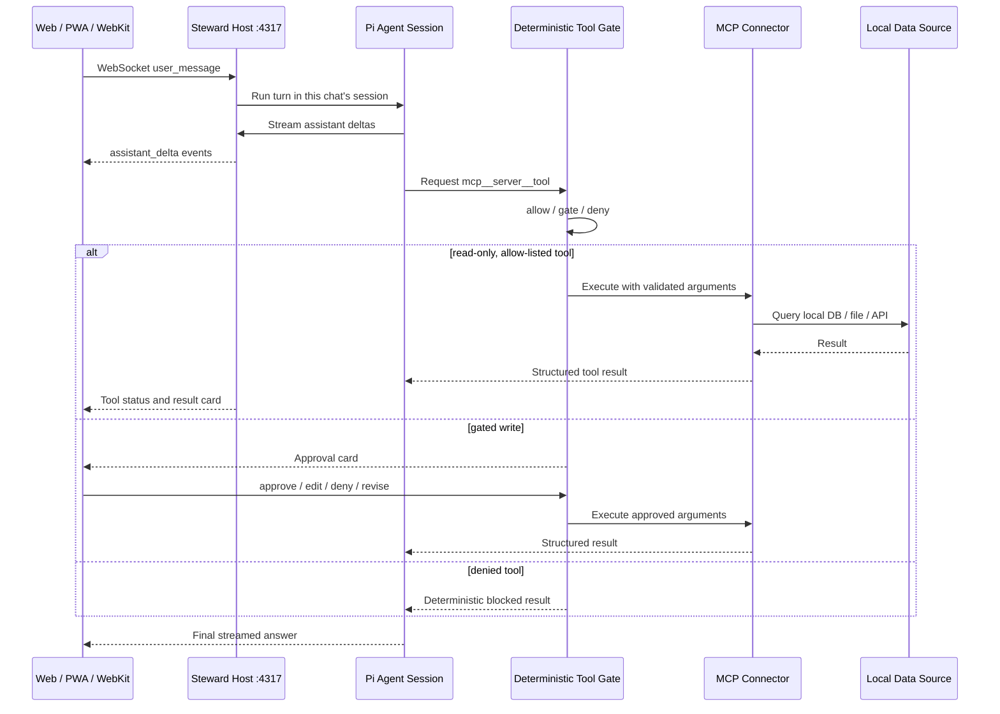

Each chat has a persisted Pi agent session; each channel connection owns a `Session` for approvals/questions, with `chatId` routing back to the requesting chat. `packages/mcp-bridge` converts MCP tools into Pi tools named `mcp__<server>__<tool>`. The host wraps every tool before it reaches the agent; the model never receives a direct handle to AppleScript, SQLite or the filesystem.

`ChatManager.runTurn()` serializes work per chat and returns `TurnResult` after
the normal transcript, audit, usage and status cleanup has completed:

```ts
type TurnResult =
  | { ok: true; messageId: string | null; text: string }
  | { ok: false; error: string; aborted: boolean; messageId: string | null; text: string };
```

Agent setup failures, missing/deleted chats, closed sessions, model errors and
user aborts therefore have explicit outcomes. Channel clients still rely on
streaming protocol events for live rendering; headless callers use the return
value for control flow.

The UI receives protocol events rather than provider-specific objects. Messages, tool starts/results/errors, questions, approval requests and Action Center state therefore remain portable across the browser, installed PWA, native WebKit window and future clients.

### A Phone Call From HTTP To SIP And Back

Voice is a channel over the same `ChatManager`, not a second assistant. The
transport owns SIP media; the host still owns chat identity, agent context,
tool policy, approvals, Audit and Usage.

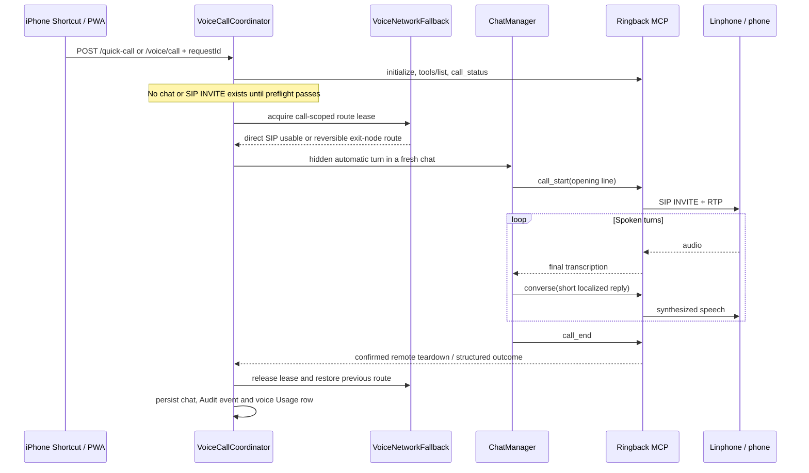

`/quick-call` accepts only an empty object or `requestId`; `/voice/call` also
accepts a bounded custom `openingLine`. Both routes use the normal bearer token,
return `202` once the asynchronous turn has started, and create a new chat only
after Ringback passes preflight. Preflight checks MCP startup, presence of
`call_start`, `call_status`, and `call_end`, then calls `call_status`; this safe
check is retried once, whereas a real unanswered call is never blindly redialed.

Ringback has one process-global SIP session, so the coordinator admits one call
at a time. A second request receives `409`, `retryAfterMs` and the live state.
Caller-supplied request IDs are cached for ten minutes: replaying the same HTTP
request returns the original `chatId` instead of issuing another INVITE. Status
exposes `preflighting`, `starting`, `ringing`, `speaking`, `listening`,
`processing`, `ending` and `failed` phases; the client polls
only while a call is active.

The call is started by a hidden host control turn, so “call the user now” is not
misrepresented as a user-authored transcript message. Ringback transcription is
returned to the same persisted agent session, which can query memory and
read-only connectors between spoken turns. `packages/mcp-bridge` preserves
empty successful content blocks instead of treating them as missing results,
preventing a completed transcription from becoming a silent agent turn.
The host snapshots the selected English/Italian locale for its active-call
prompt and approval vocabulary. Ringback reads the persisted language before
later Whisper inference and localized `say` synthesis, so settings changes do
not require rebuilding its model runtime.

Terminal media state is data, not inferred from whether the MCP request itself
resolved. Steward parses Ringback's `[CALL FAILED]` JSON marker and preserves
stable outcomes (`no_answer`, `rejected`, `busy`, `unreachable`, `timeout`,
`auth_failed`, `server_error`, `media_error`, `media_stalled`,
`media_interrupted`, `network_error`). Socket/reset language can reclassify a
nominal SIP 503 as a network failure while retaining the original status and
reason. The first actionable media failure is latched: a later `NO ACTIVE CALL`
during cleanup or an interrupted approval cannot overwrite it. Duration,
failure code and SIP diagnostics flow to `/voice/status`, Audit and the dedicated
voice section of Usage.

The native Ringback patches make this contract observable at the media edge.
They use CoreAudio for a stable pjproject conference bridge while keeping the
Mac microphone out of RTP, run half-duplex turns, require confirmed remote SIP
teardown, and distinguish two legitimate silent replies from a connected call
whose incoming RTP has stopped. Detailed SIP diagnostics are bounded by log
rotation. The managed shell wrapper launches the asynchronous Python MCP child
with explicit `<&0`; without that redirection non-interactive Bash would replace
stdin with `/dev/null` and the stdio server would exit during initialization.

### Live Train Lookup And Refresh

The train flow keeps station interpretation, live-source access and agent wording
separate. The model chooses the tool and explains its structured result; it does
not invent platform confidence or parse ViaggiaTreno responses itself.

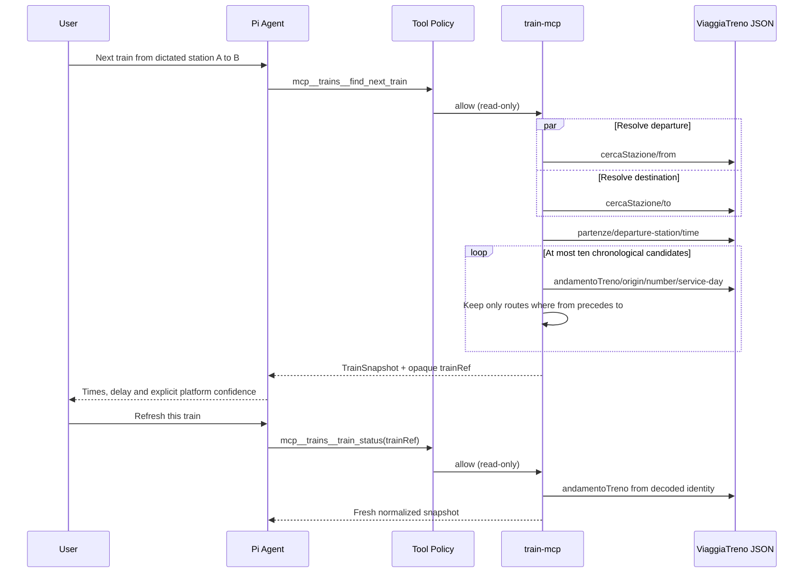

`find_next_train` accepts an optional ISO 8601 `departureAfter`. Otherwise it
uses the current time. Departure rows older than two minutes are discarded,
the remainder are sorted, and the first ten are checked concurrently. A train
is direct for this connector only when both station IDs occur in its stop list
and the destination index is greater than the departure index. The earliest
matching scheduled departure wins. A missing match is reported explicitly;
the connector does not silently synthesize a route with changes.

The returned `trainRef` starts with `vt1_` and contains a versioned base64url
JSON payload with the train number, origin station ID, service day and the
requested from/to station IDs and names. It is opaque to the model but is not a
secret or authorization token. Carrying the service day is essential because
train numbers repeat; carrying the requested segment lets later status calls
recompute the correct platform, stop positions and arrival state.

### Watch Creation, Polling And Notification

Creating a watch captures an initial snapshot immediately. Subsequent polls
compare new snapshots with the stored one; this means a watch reacts to future
transitions rather than replaying conditions that were already true when it was
created. The agent should therefore answer the current state in chat and choose
rules for what remains—for example, if a platform is already scheduled, watch
`train.platform_confirmed` or `train.platform_changed`, not its earlier
announcement.

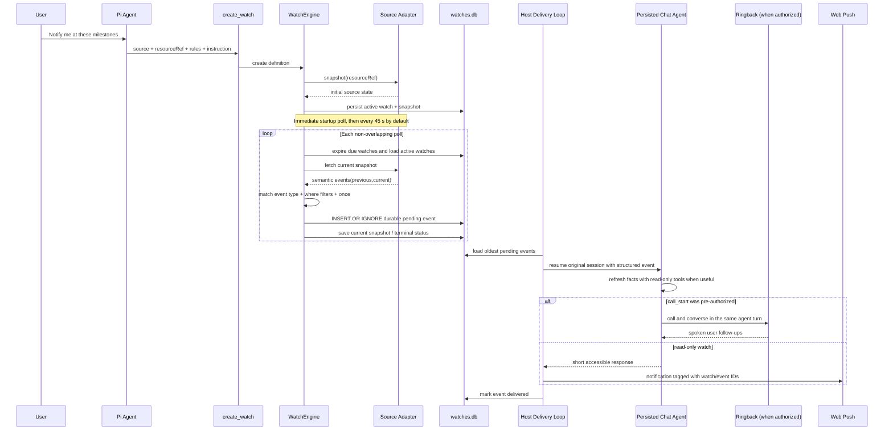

The host runs the combined poll-and-delivery loop immediately at startup and
then every `WATCH_POLL_MS` (45 seconds by default). Adapters can request a
shorter interval, down to five seconds near a time-sensitive milestone. A
process-local single-flight guard prevents overlapping executions.
Pending events are read oldest-first in batches of at most 20. If the original
chat was deleted, delivery creates a `Monitor automatici` chat rather than
dropping the event. Delivery waits when that chat already has an interactive
turn in flight, so an automatic prompt cannot be interleaved with a user turn.

The automatic prompt preserves the user's original instruction, identifies the
matched rule and treats event fields as data rather than instructions. It is
sent to the same persisted Pi session but is not rendered as a new user-authored
message; assistant and tool messages are appended normally. A process-wide
running-chat check defers the event while an interactive turn is active. The
background policy is deny-by-default: normal watches get read-only tools, while
an agent watch receives the union of grants on the rules matched by this event.
All rules matching one domain event are aggregated into one agent turn. Thus a
per-stop notification rule and a “call at the penultimate stop” rule do not
produce duplicate messages; the call is the delivery for that stop.

The push body is capped at 240 characters. On generation failure the event
remains pending; after two failed agent attempts, the third pass uses the
adapter's deterministic `fallbackText`. If every registered push endpoint
fails, the durable event is retried; its already composed notification text is
stored in `watch_events.notification_text` and reused so the retry neither
calls the agent again nor duplicates the chat message. A voice event stays
pending while the voice channel is busy, including across host restarts, and
is retried as soon as the coordinator becomes idle. A durable action claim is
written immediately before dialing, so a crash after that point does not redial
the same event. A fallback push is sent only after a call failure and only when
every matched voice rule explicitly opts in with `voiceFallback: "push"`; call-only
rules never send one. If the approved rule has a bounded
continuation and the call returns a matching structured outcome such as
`not_answered`, a distinct durable time watcher schedules the next attempt.
While the host remains running, an established call whose incoming RTP actually
stops (rather than merely having two silent replies) gets one automatic
replacement call in the same chat after three seconds. This applies to manual
and watch calls. The replacement dial has its own one-use authorization; other
watch grants retain their durable limits. Steward asks where the user last
heard it and does not automatically repeat writes or approvals. A normal
hangup, unanswered call, ambiguous silence, or host restart does not trigger
this recovery. This detects a media interruption, not the specific cause on
the phone; SIP relays can hide a client crash from the host.
Per-send reports track
attempted, delivered, failed and pruned subscriptions. Delivery is complete
when the chat copy exists and either no push endpoint is registered or at least
one endpoint accepts the notification.
The internal structured prompt is not stored as a user-authored chat message;
only the accessible notification is added to the transcript. Audit events use
the watch ID as their correlation ID, while the LLM call, source polling and
delivery are separately visible in Usage.

### Incoming Email: Apple Mail To Local Mirror

A message does not arrive in the Steward client. It first lands in Apple Mail's local store. Steward then observes and reconciles that store:

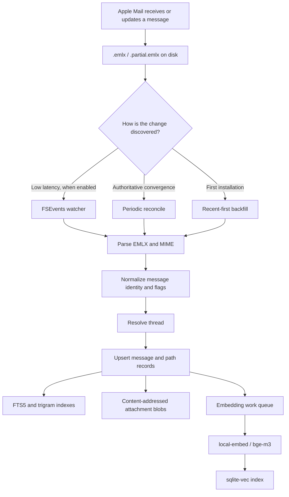

The ingestion path in `apps/mail-mirror` performs several non-obvious tasks:

1. **Parse the actual on-disk message.** The EMLX parser separates the RFC/MIME message from Apple's plist trailer, decodes Mail flags, extracts text and attachments, and reads Apple/Gmail thread metadata where available.
2. **Choose a stable message identity.** The RFC `Message-ID` is preferred. If it is absent, Steward generates a deterministic local surrogate from the account and path.
3. **Preserve mailbox specificity.** Gmail can expose the same message in a specific label and in All Mail. An All Mail copy is not allowed to overwrite a row already attributed to a more specific mailbox.
4. **Track every physical path.** A logical message can have multiple on-disk paths. Reconciliation removes missing paths first and soft-deletes the logical message only when no path remains.
5. **Classify body availability.** A normal file is `full`; a `.partial.emlx` with some text is `partial`; a partial file without usable text is `none`.
6. **Store attachments by content.** Attachment bytes are hashed with SHA-256 and placed in a blob store, allowing duplicate content to share identity independently of filenames.
7. **Keep derived indexes rebuildable.** Message rows are the local normalized record; trigram, FTS and vector structures can be regenerated from them.

There are three synchronization modes:

| Mode | Purpose | Ordering and deletion behavior |
|---|---|---|
| `backfill` | Initial import | Enumerates the archive recent-first so current mail becomes useful before old history finishes. |
| `watch` | Low-latency updates | Uses filesystem events to ingest newly created or changed EMLX paths. Filesystem events are an optimization, not the sole source of truth. |
| `reconcile` | Periodic convergence | Diffs disk paths and mtimes against the database, ingests new/changed files, removes vanished paths and soft-deletes orphaned logical messages. |

The packaged scheduler runs reconciliation periodically, so missing one filesystem event does not permanently lose a message.

### How Email Threads Are Reconstructed

Apple Mail, Gmail and standard RFC headers do not always agree on conversation identity. Steward therefore resolves a surrogate `thread_id` in descending order of confidence:

1. **Existing identity** — re-ingesting a known message keeps its current thread.
2. **Gmail thread ID** — `gm_thrid` groups Gmail messages even when useful reply headers are absent.
3. **RFC reply graph** — an already-stored message referenced by `In-Reply-To` or `References` supplies the thread.
4. **Subject and participant fallback** — normalized subject plus at least one matching participant within a ±14-day window.
5. **New thread** — if no prior signal matches, Steward creates a new thread row.

The thread table tracks normalized subject, participants, first/last activity and message count. Thread identity matters beyond presentation: search collapses duplicate message hits by thread, mail promotion produces one canonical note per thread, and Action Center reasons about the conversation rather than isolated messages.

### Body Completeness And Live Fallback

Apple Mail may keep only a `.partial.emlx` until a message is opened or downloaded. Steward does not pretend a partial body is complete:

- individual message reads expose `bodyState`; compact search pages do not;
- a useful partial body remains searchable;
- a non-`full` body with fewer than 20 trimmed characters triggers a live AppleScript read; a useful partial body is served directly;
- usable live content is returned only when longer than the mirrored body; this read does not persist the replacement into the mirror;
- if AppleScript fails, the connector returns the best mirrored body instead of failing the entire read;
- opening a `message://` deep link remains available for inspecting the source in Mail.app.

The live finder first tries a usable numeric Mail ID, then may scan globally by RFC message ID; “targeted” describes the selected message, not a guarantee of a cheap account-scoped lookup. A failed or poorer live read keeps the mirrored result and its original body state.

### Email Embedding Lifecycle

Embedding is asynchronous and content-addressed:

1. Build source text from `subject + body`, capped by `MAIL_EMBED_MAX_CHARS` (default 2,000 characters).
2. Compute a SHA-256 source hash.
3. Skip the message if its stored embedding state already has that hash.
4. Send pending texts through the shared gateway using `local-embed`.
5. Ensure that the sqlite-vec table matches the returned vector dimension.
6. Upsert the vector and record model, dimension, hash and timestamp.

Backfill normally embeds in batches of `MAIL_EMBED_BATCH` (default 32). Failure handling is intentionally granular:

- if some members of a successful batch fail, only those members are retried individually;
- if the whole batch is rejected, every item is retried individually so one malformed input cannot block healthy messages;
- a failed item remains pending for a later cycle;
- if both the batch and all individual retries fail, the worker treats the endpoint as unavailable and backs off;
- while backlog remains, the worker shortens its delay to drain quickly; when idle or unavailable, it waits longer.

Changing the source text invalidates the hash and schedules a fresh vector. A vector-dimension change resets incompatible vector state instead of mixing embeddings from different spaces.

### Email To LLM Wiki Promotion

Being mirrored or searchable does **not** mean an email becomes long-term memory. `apps/mail-promoter` is a separate, conservative pipeline:

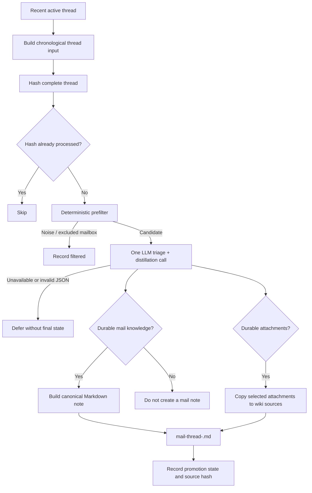

Promotion is keyed by `thread:<id>`, not by message. A SHA-256 hash covers the ordered subjects and bodies of the whole thread; unchanged conversations are not sent back to the model. A new reply changes the hash and causes the canonical note to be reconsidered.

The deterministic prefilter rejects obvious noise before any LLM cost. It uses sender, subject, body state and discovered mailbox role. Candidate threads are then classified and distilled in **one** model call. That call decides:

- whether the conversation contains durable personal knowledge;
- categories such as `commitment`, `document`, `personal-fact`, `decision` and `relationship`;
- summary, facts, commitments, people and organizations;
- an optional `review_by` date for future deadlines or events;
- independently, which attachments are durable source documents and their categories.

Mail and attachment decisions are independent: a transient email can carry a durable contract, while a useful conversation can contain disposable logos and signatures. Returned categories and attachment IDs are validated against allow-lists before use.

The pipeline deliberately distinguishes final and retryable outcomes:

| Outcome | Persisted behavior |
|---|---|
| `filtered` | Deterministic prefilter rejected the thread; its hash is recorded. |
| `skipped` | The model found no new durable knowledge; its hash is recorded. |
| `promoted` | The canonical note and/or selected attachments were written and state was recorded. |
| `deferred` | Model/wiki output was unavailable or unusable; no terminal state is written, so a later run retries it. |

A promoted note uses stable YAML frontmatter with `message://` provenance, `thread://` identity, all source message IDs, account, categories, dates, selected attachments and optional review date. Updating a thread rewrites the same `mail-thread-<id>.md` rather than creating duplicate memory.

The batch runner processes most-recently-active threads first. `runBatch()` defaults to eight workers when called directly; the `backfill` CLI passes `MAIL_PROMOTER_CONCURRENCY`, default **10**, and the scheduler runs that CLI. SQLite writes remain serialized by the JavaScript process and `better-sqlite3`.

The production `backfill` path resolves the wiki sources directory and writes notes through `makeFsWikiPromoter`: each note is written to a temporary file and renamed into place. Selected attachment blobs are copied separately. The wiki app can be closed during these writes. When promotion succeeds, the CLI attempts one API rescan at the end; a failed rescan is reported but does not undo written sources or their recorded promotion state. Reopen the wiki and run `node --import tsx apps/mail-promoter/src/cli.ts rescan` to request indexing again. Source creation and wiki-page generation are separate completion boundaries. The reusable API-backed promoter can fail/defer on API errors, but an unavailable wiki API does not by itself prevent filesystem backfill.

## Retrieval Internals

Steward does not treat “search” as one algorithm. Exact filters, lexical relevance, substring matching and semantic similarity solve different problems, so the connectors combine them while keeping deterministic filters separate from ranking.

### Dictated Station Resolution And Direct-Train Selection

ViaggiaTreno station autocomplete is prefix-oriented: a correct full name works
well, while a transcription such as “Milano rogo redo” may return no candidates
at all. Steward adds a bounded resolver above that source without learning a
personal station history.

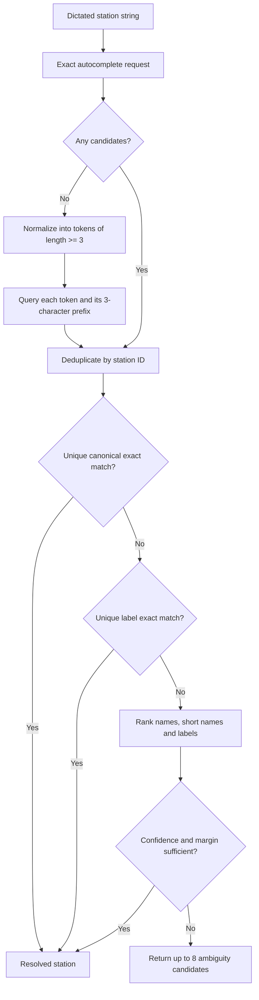

Normalization removes Unicode diacritics, replaces punctuation with spaces,
lowercases and also produces a compact no-space form. The similarity score for
each candidate name is the greater of:

```text
0.55 * normalized Levenshtein similarity
+ 0.35 * padded-trigram Dice similarity
+ 0.10 * query-token overlap

or

0.92 * containment ratio, when one compact string contains the other
```

A sole candidate is accepted at `>= 0.68`. With multiple candidates, the best
score must be at least `0.86` and lead the runner-up by at least `0.08`.
Otherwise the MCP result is `ambiguous_station`, allowing the agent to ask a
short clarification instead of guessing. Canonical name/short-name exact
matches take priority over generic labels: this prevents all stations whose
label is simply “Monza” or “Modena” from looking equally exact. All fallback
queries derive only from the current utterance; no habitual-station list, wiki
lookup or conversation-memory expansion enters the resolver.

After both stations resolve, direct-train selection uses live identifiers, not
name comparison. For each departure candidate, the connector fetches the full
run and locates `fromId` and `toId` in its stop array. Only `toIndex > fromIndex`
qualifies. This also gives every normalized stop a stable
`positionRelativeToDestination = stopIndex - toIndex`, which later powers
“one stop before” and “get off here” rules without hard-coding station names.

### Train Snapshot Normalization

The ViaggiaTreno response shape varies between departure-board and train-status
endpoints. `TrainService` collapses it into one `TrainSnapshot` contract:

| Normalized field | Source precedence / invariant |
|---|---|
| Service identity | Train number + origin station + service-day milliseconds; status falls back from the three-component endpoint to the current-day two-component form only on `404`/`204`. |
| Requested segment | Exact station IDs and indexes from the `trainRef`; destination must follow departure. |
| Scheduled times | Stop-level theoretical/programmed values, then departure-board/run-level values; display formatting always uses `Europe/Rome`. |
| Estimated times | Actual timestamp when present, otherwise scheduled timestamp plus normalized delay. |
| Delay | Departure-stop delay, stop delay, run delay, then board delay; defaults to zero. |
| Platform | Effective departure platform first, otherwise programmed platform. `platformStatus` is `confirmed`, `scheduled` or `unknown` accordingly. |
| Cancellation | Train cancellation codes/provisions or a cancelled requested departure stop. |
| Departed | Explicit board state, an actual departure timestamp, or the last detected station occurring after the requested departure index. |
| Arrived | Run-level arrival state or an actual arrival timestamp at the requested destination. |
| Stops | IDs, names, scheduled/actual arrival and departure, cancellation flag, index and relative position to the requested destination. |

Missing values are omitted rather than converted into plausible-looking
defaults. Programmed and effective platforms remain separate fields even when
the convenience `platform` field chooses one. Every snapshot includes
`lastUpdated`—the time Steward performed the normalization—and
`source: "ViaggiaTreno"` so the agent can qualify freshness and provenance.

The HTTP client uses a 10-second timeout and at most two attempts per request.
It accepts both JSON and the pipe-separated station autocomplete form, treats
`204` as no live data where appropriate, and makes endpoint substitution
configurable through `VIAGGIATRENO_BASE_URL`.

### Mail Search: Structured, Lexical, Substring And Semantic

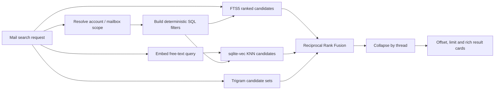

The mail connector supports four complementary retrieval modes:

| Mechanism | What it answers well | Implementation |
|---|---|---|
| Structured SQL filters | “Unread mail from June with attachments in this account” | Dates, flags, account, mailbox, role, size and attachment constraints are composed with AND semantics. |
| FTS5 lexical ranking | “invoice renewable energy” when those words occur in the message | The free-text query is safely quoted into an FTS5 `MATCH` expression and returns up to 50 ranked candidates. |
| Trigram substring search | Partial names, address fragments, subject/body substrings | A dedicated FTS5 trigram table drives candidate selection for strings of at least three characters, avoiding full `LIKE` scans over inline message bodies. |
| Vector KNN | “the document my accountant sent about taxes” when wording differs | The query is embedded through `local-embed` and searched against `sqlite-vec`, normally using local `bge-m3` vectors. |

The actual algorithm is:

1. Resolve logical scope. Account names, explicit mailbox names, mailbox roles and “any mailbox” are normalized before SQL generation.
2. Build SQL for deterministic filters. These constraints apply independently of how results are ranked.
3. For substring arguments such as `sender`, `recipient`, `cc`, `subjectContains` and `bodyContains`, query the trigram index. Multiple substring constraints are intersected.
4. If `query` is present, retrieve at most 50 FTS5 candidates.
5. If embeddings are enabled, embed the query and verify that its vector dimension matches the stored index.
6. Retrieve at most 50 nearest vector candidates.
7. Reapply structured filters to vector hits while preserving KNN order.
8. Fuse lexical and semantic rankings with Reciprocal Rank Fusion (RRF, default constant `k=60`). RRF combines rank positions instead of attempting to compare incompatible BM25 and vector-distance score scales.
9. Intersect the ranked output with trigram candidates when substring constraints are present.
10. Unless `perMessage` is requested, keep only the highest-ranked message from each thread.
11. Materialize summaries in ranked order and apply offset/limit.

When no free-text query is supplied, search becomes deterministic browsing: the connector orders a wider pool (up to 500 messages) by date or size, then applies filters, substring candidate sets, offset and limit. This is important for requests such as “show the ten largest attachments from last month,” where semantic ranking would be meaningless.

Examples:

| User intent | Retrieval path |
|---|---|
| “Find the solar certification email” | FTS5 + vector KNN → RRF → thread collapse |
| `subjectContains: "certificat"` | Trigram candidate set |
| `sender: "marco", after: "2026-06-01"` | Trigram sender match intersected with date filter |
| “The PDF my accountant sent about property taxes” | Semantic retrieval can match without exact wording; lexical hits strengthen the RRF rank |
| “Newest unread messages in Inbox” | Structured filters and date ordering; no embedding needed |

If the embedding endpoint is disabled or unavailable, `vecIds` is empty and the same request degrades to lexical/trigram search. The local mirror therefore remains useful without any model provider.

### Reading A Mail Result

Search returns `{ messages, page }`, default eight results and hard maximum 12 per MCP page. Summaries contain `id`, subject, sender, date, account, mailbox, snippet, optional `threadId` and `mailUrl`; the snippet is capped at 200 characters for the first three results and 120 afterwards. `bodyState` and full attachment metadata belong to message reads. These public page limits are separate from the search engine’s internal 100-row limit and bounded candidate pools. A separate read resolves the selected message:

1. Reject rows that have been soft-deleted.
2. Load subject, sender, date, mirrored body and attachment metadata from SQLite.
3. If the body is non-`full` and has fewer than 20 trimmed characters, try the live Mail finder through AppleScript.
4. Accept live text only if it is usable and more complete than the mirror.
5. Return the best body, explicit body state, attachments and deep link.

Keeping search and read separate avoids sending entire email bodies through the agent context when a ranked summary is enough.

Thread reads and individual large message bodies are paginated as well. The first page favors the context most likely to answer the request and exposes continuation offsets when older thread history or another exact body range is materially necessary. Calendar, contact and LLM Wiki results follow the same compact-page pattern; complete records or later pages are fetched only on demand.

### Calendar Search

Calendar reads start from Apple's Calendar CoreData store under `~/Library/Group Containers/group.com.apple.calendar/`. The indexer normalizes events into Steward's SQLite index and optionally adds `local-embed` vectors.

`search_events` accepts independent dimensions:

- a free-text `query`;
- start/end time range;
- account;
- calendar;
- result limit.

All supplied constraints are ANDed. With an index and a free-text query, lexical and semantic rankings are combined. A pure time-range query does not pay for an embedding. If the sidecar search index is unavailable, the connector can fall back to direct event-range reading, preserving basic availability and chronological lookup.

This separation supports distinct questions efficiently:

| Question | Important signals |
|---|---|
| “What starts Thursday afternoon?” | Start-time range and calendar filters; semantic search is unnecessary. |
| “Meetings about the certification project” | Hybrid text/vector relevance constrained to an event window. |
| “What was my appointment with Marco in May?” | Name/title relevance plus historical time range. |

Calendar writes never modify the CoreData database directly. The Node connector journals the approved operation, then selects EventKit or the AppleScript compatibility path. Later Calendar sync reads the Apple-owned store and write reconciliation checks the indexed result.

Time browsing uses half-open overlap: an event matches when `event.end > start`
and `event.start < end`. The default window is 30 days back to 90 days ahead.
With the launcher bridge, explicit date windows and query-free browsing use
EventKit to expand recurring occurrences, apply account/calendar and lexical text
filters, and paginate compact results. Native windows above 366 days or results
above 1,000 occurrences fail explicitly rather than silently truncate availability.
Each occurrence includes `occurrenceStart` for subsequent reads or writes.

Indexed hybrid text search without explicit dates remains an entity search over
stored event rows and does not impose the default window. Without the bridge,
range retrieval applies overlap and all supplied text terms. If relevant recurring
masters exist, it fails explicitly because it cannot establish complete occurrence
availability. Search is still subject to Apple permissions, source freshness and
the selected calendars; it is not a transactional reservation of a time slot.

### Calendar Write Transport And Identity

The Calendar connector selects its write backend per operation, not merely by OS
version. The Swift launcher targets macOS 14+ and starts `CalendarEventKitBridge`;
its managed children receive `STEWARD_CALENDAR_BRIDGE_DIR`. A standalone Node
host without that environment uses AppleScript. A configured but unresponsive
bridge is an error, not permission to switch backends and repeat an uncertain
write.

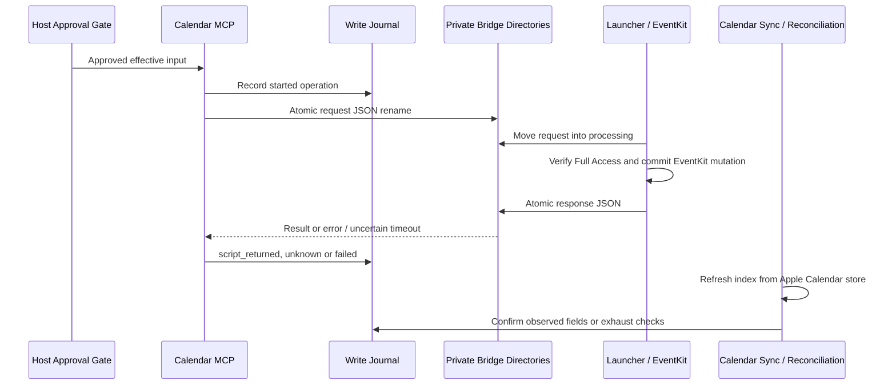

The default bridge root is
`~/Library/Application Support/Steward/calendar-bridge/`. Directories are created
with mode `0700`; Node requests use mode `0600`, a random UUID filename and a
temporary-file rename. Swift polls every 100 ms on a serial queue and moves a
request from `requests/` to `processing/` before execution. Responses are written
through a temporary path into `responses/`; Node checks every 50 ms, consumes the
response, and normally waits up to 30 seconds. This is local per-user IPC, not an
authenticated network API or protection against another process running as the
same macOS user.

On launcher restart, requests left in `processing/` receive `outcomeUnknown`.
They are not replayed. Requests carry `expiresAtMs`, checked before native
execution. On timeout, Node withdraws an unclaimed request from `requests/` and
reports that it was not executed. If Swift already claimed it, the result remains
uncertain: the external mutation can finish after its caller stopped waiting.
Expiration and withdrawal prevent stale queued execution; neither rolls back an
operation already running.

| Operation | EventKit path | Compatibility path |
|---|---|---|
| Create | Available bridge and representable recurrence; select calendar by stable `calendarId`. | Without a usable representation or configured bridge, resolve the ID and require a unique calendar title before AppleScript creation. Duplicate titles fail. |
| Update | Available bridge and representable recurrence; resolve historical UID aliases before dispatch. `scope` selects `thisEvent` or `futureEvents`. | Nonrecurring updates by UID only; recurring updates and `futureEvents` fail before dispatch when EventKit cannot be used. |
| Delete | Available bridge; `thisEvent` default or `futureEvents`. Result reports `pending_confirmation`. | `thisEvent` only; `futureEvents` is explicitly rejected. |

The RRULE parser accepts `DAILY`, `WEEKLY`, `MONTHLY`, `YEARLY`, `INTERVAL`,
`COUNT` or `UNTIL`, `BYDAY` (including ordinals), `BYMONTHDAY`, `BYMONTH`,
`BYWEEKNO`, `BYYEARDAY` and `BYSETPOS`. Unsupported/duplicate components are not
silently discarded: they make the recurrence unrepresentable for this bridge.
Compatibility selection is not a promise that Calendar.app will accept every
other RRULE. Attendees/invitations are not exposed by either tool schema.

Calendar identity is also eventually consistent. The sidecar keeps an internal
`ref_id` and historical UID aliases. A sync first recognizes the current UID or a
known alias. Otherwise it attempts one unambiguous match using external ID,
account, calendar and start, or—without an external ID—account, calendar, times,
all-day flag, summary and location. Generation tracking excludes rows already
observed in the same sync, preventing two simultaneous equal events from being
merged through that heuristic. Multiple candidates receive a new identity rather
than an arbitrary match. A rebuilt index loses aliases that cannot be recovered
from the current Apple store.

`read_event`, update, delete and reconciliation resolve historical UID aliases.
Recurring changes require an explicit `occurrenceStart` and native scope;
`read_event` accepts that selector too. One-sided time edits are checked against
the live unchanged boundary before journaling, and EventKit checks effective
boundaries again. The index publishes metadata, deletions and its completed-sync
marker atomically before optional embeddings. Confirmation never treats a partial
or pre-write sync as evidence of deletion. See [the audit register](docs/readme-code-audit.md)
for implemented safeguards and remaining integration limits.

### Contacts Search And Recipient Resolution

The contacts connector reads the top-level and per-source AddressBook stores, normalizes labeled emails/phones and builds a local hybrid-search index.

Contacts can appear in multiple iCloud, Exchange or local sources. Indexing uses an email-first deduplication heuristic: records sharing a primary email are merged under a sidecar `uid`, and the result retains the source UUIDs that contributed data.

`search_contacts` answers general discovery queries. `resolve_recipient` is stricter: it returns a ranked list of email-bearing candidates for descriptions such as “Anna from Polimi” or “my accountant,” but **does not auto-pick one**. Ambiguous identity remains an agent/user decision before a mail tool is proposed.

The index `uid` is distinct from Contacts.app's `personId`. Reads use the sidecar UID; AppleScript updates require the native person ID. Documenting both prevents a subtle but dangerous identifier mix-up.

### LLM Wiki Search

The wiki is a different retrieval layer from raw-source search:

- mail/calendar/contact indexes answer questions from normalized source records;
- LLM Wiki answers questions from durable, distilled Markdown knowledge;
- wiki pages preserve provenance and can link related people, projects and decisions;
- vector search finds semantically related pages;
- wikilinks and the graph expose explicit relationships;
- Deep Research and graph insights operate over the curated knowledge layer rather than every raw message.

The agent can use both layers in one turn. A question about an established project decision may be answered from the wiki; a request for the exact latest email should query the mail mirror and open the source.

### Source Import Destination And Collision Semantics

`wiki-add` is explicit user-driven snapshot import, separate from read-only
document tools and automatic mail promotion. One input opens a native Save As
panel; multiple inputs choose a shared folder, optionally after selecting files
from folders. Cancellation or a destination outside `raw/sources/` stops the
copy. `--root` provides a noninteractive structure-preserving path. Hidden files,
known build/junk directories, unsupported types and files above 100 MiB are
skipped during collection; wiki import supports more source types than Documents
MCP and still depends on downstream parser support.

The project-root `.llmwiki-added.json` maps origin paths to source destinations.
For tracked origins, an ordinary re-add updates the recorded destination. An
explicit panel or `--root` destination relocates the tracked snapshot: the new
copy and manifest are published before the previous copy is removed. A snapshot
still referenced by another deduplicated origin is preserved; a changed shared
origin receives its own copy. Losing the
manifest loses that origin-to-destination continuity; identical content can
still be skipped by hash, but a changed source can be treated as an unrelated
collision instead of an update.

`packages/source-collision` shares the decision algorithm between Node and wiki
frontend import paths:

| Destination state | Import decision |
|---|---|
| Missing | Write the source. |
| Same SHA-256 content hash | Skip duplicate bytes and retain tracking. |
| Different bytes, known tracked origin | Overwrite its recorded snapshot. |
| Different bytes, unrelated origin | Find `name (2).ext`, then the next available suffix. |

The helper decides; the Node importer serializes writers with a per-project
`.llmwiki-added.lock` and publishes the manifest by atomic rename. Unrelated
copies use exclusive creation with collision retries; tracked replacements use a
temporary file and rename. Destination ancestors are canonicalized, symlink
escapes and traversal are rejected, and collection does not follow symlinks.
A crash after manifest publication can leave the old copy orphaned, but the
manifest points to the published new copy. Stale locks fail closed: verify no
writer remains before removing one. These CLI safeguards do not turn other wiki
frontend import paths into a global filesystem transaction. After changed copies, the CLI attempts an API rescan and
reports `rescanned`; a successful copy with an unavailable API remains a valid
source snapshot awaiting wiki discovery/indexing. See [wiki-add](apps/wiki-add/README.md)
for commands and Finder Quick Actions.

### Local File Search And Safe Command Execution

`apps/shell-mcp` separates file discovery from command execution. Its read-only runner accepts familiar shell-like pipelines but does not invoke a general shell:

- input is parsed into commands and explicit argument arrays;
- only allow-listed binaries are available;
- command substitution, arbitrary redirection and other dangerous shell constructs are rejected;
- shared sensitive-path rules block secrets and protected locations;
- file-mutating commands use a separate gated tool.

This retains useful operations such as sorting or inspecting local files without giving model-generated text the authority of `sh -c`.

### Bounded Document Reading And Search

Document tools operate on one explicitly selected local file. The workflow is
`find_files` or attachment save/upload → `document_info`/`document_search` →
`document_read` on selected cursors. They do not create a persistent whole-disk
document index or automatically ingest the file into the wiki.

| Tool | Result and continuation contract |
|---|---|
| `document_info(path)` | Name, canonical path, format, size/mtime, total extracted pages/characters, warnings and up to 50 heading entries with cursors. No full body is returned. |
| `document_read(path, page? / cursor?, max_chars?, max_pages?)` | Default 6,000 characters and one page; hard caps 12,000 and three pages. Returns selection/stats plus `navigation.hasMore` and `navigation.nextCursor`. `page` and `cursor` are mutually exclusive. |
| `document_search(path, query, max_results?, context_chars?)` | Default five excerpts of 300 characters; maxima ten results and 800 context characters, plus ellipsis markers. Each match carries page, offset and a cursor usable by `document_read`. |

Extraction preserves PDF pages and PPTX slide numbers. Plain text, stripped
HTML/RTF, DOCX raw text and ODT text are represented as a single logical page;
these page counts are not equivalent to an Office print layout. HTML scripts and
styles are removed rather than executed. PDFs use their text layer; an image-only
PDF returns `no_extractable_text`, without automatic OCR or a vision call.

Before extraction, the connector requires an absolute path, checks shared
sensitive-path policy, canonicalizes symlinks, checks the resolved path again,
and requires a regular file with an allowed extension. Default input size is
25 MiB (`DOCUMENT_MAX_BYTES`, capped at 100 MiB). Extraction runs in a dedicated
worker; a 15-second timeout (`DOCUMENT_EXTRACT_TIMEOUT_MS`, clamped to 1–60 s)
terminates that worker, including synchronous parser execution. Its V8 old heap
defaults to 256 MiB (`DOCUMENT_WORKER_HEAP_MB`, 64–512). Extracted output is
limited to eight million characters (`DOCUMENT_MAX_EXTRACTED_CHARS`, maximum
32 million). Office ZIP directories are checked before inflation: default 64 MiB
of declared decompressed content (`DOCUMENT_ARCHIVE_MAX_BYTES`, maximum 256 MiB)
and 10,000 entries; ZIP64/multipart archives are rejected. These are resource
controls, not an OS sandbox or a bound on all native/external memory allocations.

Extracted documents use an eight-entry process-local LRU with an estimated
aggregate text/chunk/vector budget of 64 MiB (`DOCUMENT_CACHE_MAX_BYTES`, maximum
256 MiB). Entries are evicted after extraction and after vectors are added. The
key is canonical path, byte size and mtime; restart discards the cache. Cursors
include a fingerprint of that key and stale/unversioned cursors are rejected.
Extraction also rejects files changed while the worker ran. This detects normal
edits, not adversarial replacement preserving identical stat metadata; cursors
are continuation tokens rather than immutable citations.

Search splits every page into nominal 1,800-character chunks with 200-character
overlap, preferring nearby sentence/newline boundaries. Lexical ranking covers
all extracted chunks, normalizes case/diacritics and rewards phrase matches and
bounded term counts. It retains at most 50 candidates. Semantic search uses at
most 256 evenly sampled chunks, embeds them in batches of 64, and compares the
query vector by cosine similarity against valid same-dimension vectors. It also
retains at most 50 candidates; RRF merges the two rankings.

The response reports `search.semantic` as `disabled`, `unavailable`, `full`,
`sampled` or `partial`, with selected and successfully embedded chunk counts.
`full` requires valid vectors for every selected chunk and no sampling; `partial`
reports missing vectors explicitly. Large files warn about sampling while lexical
search covers all extracted text. Failed vectors are retried on a later search;
endpoint/model/dimension changes invalidate cached vectors. Embedding failure
continues to yield bounded lexical results, and the initial parser still reads
the supported file in full.

Default embeddings use gateway `local-embed`, attributed as
`documents-mcp / search-embed`. `DOCUMENT_EMBED_ENDPOINT=off` disables them;
model, endpoint, dimension and API key have separate document overrides. Tool
calls use normal host Usage/Audit wrappers; cached extraction itself is not a
persistent document store. See [Documents MCP](apps/documents-mcp/README.md).

## Approval And Write Reliability

Model intent, user authority and operating-system effects are separate stages.

### Deterministic Tool Policy

Every Pi tool definition is wrapped by the host before being exposed to the agent. `decideTool` returns exactly one of:

- `allow` — execute immediately; reserved for known read-only tools;
- `gate` — emit an approval request and wait;
- `deny` — return a blocked result without asking.

The default is `gate`, not unconditional rejection: an unfamiliar interactive tool normally requires approval. Known mail/calendar/contact/wiki/document/train reads and write-journal review tools and selected safe operations are explicitly allow-listed. Generic read-only watch creation and stopping are automatic. `create_agent_watch` is gated because a rule can grant a registered future capability. At execution time the headless policy enables only tools granted by the matched rules; a second deterministic guard checks every argument against generic field constraints, and a durable claim prevents retries from repeating the action. In those background turns, unknown/ungranted tools and unconstrained write fields are rejected. Deny prefixes can disable whole namespaces. This policy is ordinary TypeScript code, not a sentence in the system prompt, so prompt injection cannot redefine it.

### Approval Lifecycle

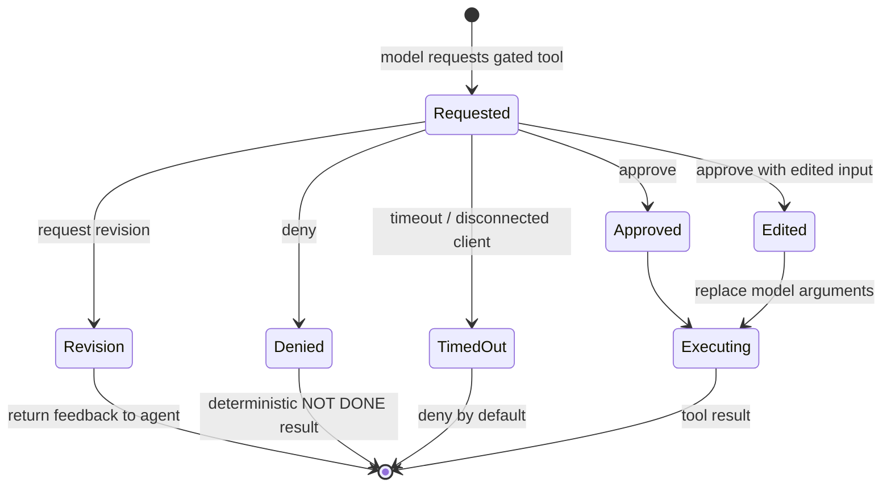

The approval card carries the proposed tool and arguments. The user can approve them unchanged, replace individual arguments, deny with a note or ask the agent to revise the proposal. Approve-with-edit is enforced in the gate: the connector receives the edited input, not the model's original input. For tools that provide `preflightInput`, the gate validates/normalizes the proposal before approval and validates edited arguments again afterwards; other tools still rely on connector validation. The effective execution input is recorded in the host tool card/transcript, so reopening a chat does not display the superseded proposal as the executed request. Optional fields left absent in the editor remain absent rather than becoming invented empty values.

Blocked results distinguish explicit rejection from timeout, unrecognized voice intent and channel failure. All prevent execution, but only the explicit rejection is described to the agent as “denied by user”.

Pending approvals live in the chat's `Session` and expire after `APPROVAL_TIMEOUT_MS`. A timeout resolves to denial. The headless `/quick-send` runner has no attached client; if it reaches a gated write, the approval request has nowhere to go and safely times out rather than executing unattended.

### Spoken Approval Is A Host Sub-Protocol

A phone call does not weaken the desktop policy. `allow` tools remain automatic,
`deny` remains non-overridable, and a `gate` request pauses the agent while the
host talks to Ringback directly. The coordinator serializes approvals against
the single active media session and deterministically reads the exact tool,
canonical arguments and approval preview. The model neither writes this prompt
nor interprets the answer.

The accepted commands are exact localized intents: approve, reject or repeat.
“Repeat” replays the immutable request; ambiguous input gets one constrained
retry and then resolves to denial. The host calls the original
`Session.resolveApproval` request at most once, so the normal permission gate
executes the unchanged input only after a positive command. Voice does not offer
approve-with-edit: revisions return to the richer PWA flow. Prompt, repeat,
decision/failure and timing are correlated to the same request in Audit and
recorded as `voice.approval` in Usage; audio itself is not retained.

`create_agent_watch` receives a human-readable spoken summary rather than raw
nested JSON. It names the future time/event, constrained capabilities, retry
continuation and whether push fallback was explicitly authorized. This is only
presentation: the actual authority remains the parsed, rule-scoped grant stored
by the watch engine.

### Voice Recovery And Call-Scoped Network Changes

There are two deliberately different retry paths:

1. A `network_error` before the phone connects may switch once to a configured
   Tailscale exit node and retry the dial in the same chat. A 20-second bounded
   probe loop waits for macOS to actually route new TLS sockets; the CLI can
   acknowledge the selection before the route is usable.
2. `media_interrupted` after a connected call schedules one replacement call
   after three seconds in the same persisted chat. It asks what the user last
   heard, does not assume the last utterance arrived, never repeats an external
   write automatically, and requires any interrupted approval again. Normal
   hangup, no answer, rejection, silence and a failed recovery do not recurse.

The network fallback is a lease, not a permanent VPN preference. Before changing
the route it atomically journals the selected and previous Tailscale peer IDs,
then addresses the exit node by its current `100.x` IP from `tailscale status`.
Release restores the previous route only if the configured call route is still
selected, so a user's manual mid-call change wins. Startup tries to repair a
stale journal left by a crashed host before issuing another lease. Settings
cannot change while a call is active, only an online peer advertising
`ExitNodeOption` is accepted, and SIP reachability is verified with an
authorized TLS connection to `sip.linphone.org:5061`.

Recovery authority is equally narrow. A manual call receives the normal voice
policy. A watch call receives only the union of grants on the rules matched by
that event plus one dial. A replacement call gets one fresh dial claim, while
all other tools remain subject to the original durable guard. This prevents a
transport retry from becoming a second authorization for mail, calendar or
other side effects.

### Journal, Confirmation And Retry

Approval answers “may this be attempted?” It does not prove that Mail.app or Calendar.app actually committed the operation. Side-effecting connectors therefore use `packages/write-ops`:

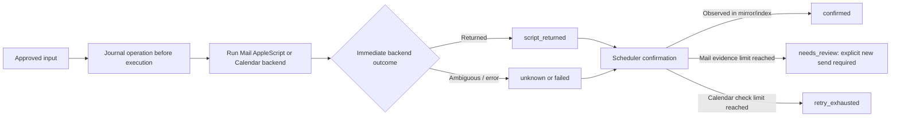

The journal stores operation kind, **executable input**, expected observable outcome, attempts, confirmation attempts, timestamps and result/error. Inputs are not audit-redacted: scheduled mail needs its complete body and attachments, and calendar confirmation needs expected fields. The separately emitted Audit copy is redacted. Treat `write-ops/ops.db` as primary sensitive operational state.

Mail confirmation reads the mail mirror; Calendar confirmation reads the synchronized index. `script_returned` means the backend returned, not that reconciliation has confirmed success. The same journal state is used after an EventKit response even though the historical name mentions a script.

Scheduled mail adds `scheduled` and `scheduled_for`. Before each external send,
`write-ops-send-due` atomically claims the due row: only a still-due `scheduled`
row can become `started`, with an incremented attempt count and `attempted_at`.
Other scheduler processes cannot claim it again. A crash after claiming, whether
before or after Mail sends, goes through confirmation and eventually review;
it never automatically requeues the send. This favors avoiding duplicates and
can require explicit user recovery of an unsent message. There is no end-to-end
exactly-once guarantee across SQLite and Mail.app.

The write journal is also an operational source for the audit trail, but the two stores have different roles: `write-ops` drives correctness and retry state; `audit-log` provides a redacted human-readable history.

### Confirmation Evidence And Retry Boundaries

Reconciliation reads up to 100 eligible operations per pass, including
`script_returned`, uncertain/failed states, retry states and `started` operations
unchanged for at least 60 seconds. This recovers journal entries whose caller
crashed before recording a response. It cannot atomically observe the external
system together with the journal.

**Mail:** confirmation requires an active message in the matching account's
Sent-role mailbox, an owned sender matching any explicit `from`, the expected
subject, exact normalized To/CC recipient sets and full normalized outgoing body.
Replies also require linkage to the original message. The matching window starts
one minute before the actual attempt and ends 24 hours later, so scheduled sends
use their execution time rather than enqueue time. Multiple matches are ambiguous.
BCC and reply-all cases without sufficient recipient evidence remain unconfirmed;
Mail-added signatures or altered body representations can also require review.

No reconciliation path automatically resends or restarts Mail. Failed, unknown,
returned-but-unconfirmed and interrupted legacy retry states only seek evidence.
After 12 checks by default, Mail becomes `needs_review`. `list_write_operations`
returns bounded review summaries; `read_write_operation(operationId)` exposes the
stored evidence. A new send requires an explicit user request and normal approval,
not inference from an unconfirmed operation.

**Calendar:** confirmation resolves UID aliases and compares expected supplied
fields: calendar selector, title, location, description, URL, effective times,
all-day state and normalized alarms. Timed values use instants; all-day boundaries
use local civil dates across DST. Canonical native RRULE comparison normalizes
interval and ordered BY-components and requires one supported rule; presence
alone is insufficient. Recurring or future-scope operations require native
read-back evidence, including the selected occurrence. This checks observable
state, not every future expanded instance or provider-side invitation delivery.

Index evidence requires a completed source sync that **started after** backend
completion, recorded with millisecond precision. Legacy second-resolution records
use a conservative extra-second barrier. Delete also requires a pre-write target
baseline before absence can confirm it. Native read-back can supply fresh evidence
without waiting for the sidecar. Errors remain bounded confirmation attempts.

A create without a returned UID requires exactly one matching candidate from a
bounded set. A failed create without usable identity can exhaust immediately;
other Calendar operations normally exhaust at 12 checks. Calendar reconciliation
never re-executes writes. Exhaustion or review means “not confirmed”, not rollback;
inspect the source application before explicitly requesting another mutation.

## Proactive And Background Processing

### Action Center Lifecycle

Action Center and mail-to-wiki promotion consume some of the same mail mirror, but answer different questions:

- **mail-promoter:** “Is there durable knowledge worth remembering?”
- **Action Center:** “Is there unresolved work that may need the user's attention now?”

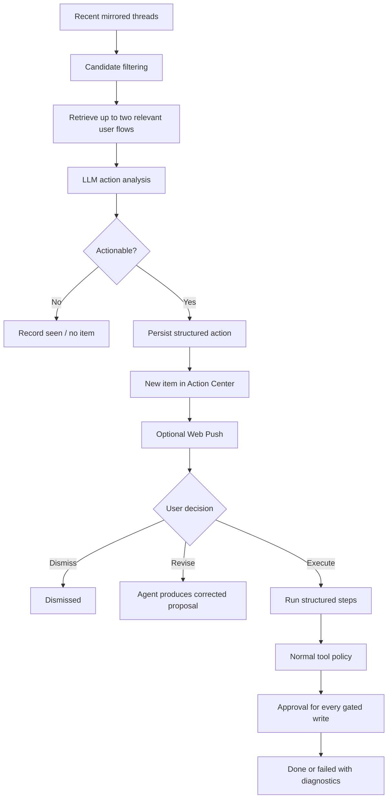

An action item stores source identity, title, summary, status, proposed steps and diagnostics. A proposed action can contain:

- a **tool step**, with a concrete MCP tool and arguments ready for policy evaluation;
- a **manual step**, for work Steward cannot automate safely, with explanatory links instead of invented tool calls;
- a confidence level and summary explaining the proposed alternative.

The item separately retains a context snapshot with the triggering mail, relevant calendar/contact/wiki context, read-tool observations, planning rationale and the exact ID/version of any applied flow. That snapshot lets chat refinement continue without silently reinterpreting the original trigger or a later edit to the flow.

Flow retrieval combines local embeddings with a lexical fallback and returns at most two enabled candidates. Retrieval happens before the actionable/not-actionable decision, so an explicit procedure can turn an otherwise informational signal—such as a purchase confirmation—into useful proposed work. The planner must still verify that the flow's trigger matches and no exclusion applies. Historical examples may supply stable recipients or message structure, but cannot override current dates, stations, booking identifiers or other case-specific facts. During historical replay, mail searches are capped at the simulated current time to prevent future information leaking into the plan.

Generating a plan does not authorize it. Executing an Action Center step reuses the host's deterministic tool policy and approval UI. A prepared email reply still becomes a gated mail write.

Items move through `new`, `read`, `done` and `dismissed`; opening an item marks it read, while completion/dismissal is explicit. A handled item stays closed unless genuinely newer activity appears on the same source thread.

Cross-thread resolution handles a common real-world edge case: a later message can answer an open task while landing in a different Mail thread. Candidate actions are conservatively limited by correspondent domain and recency. If the new message actually answers or meaningfully updates the task, Steward updates the action's summary but **does not auto-close it**; the user reviews and confirms the resolution.

The scanner also has deliberate backlog and thread semantics:

1. On first activation, it normally marks the existing recent window as seen instead of generating dozens of stale actions. Set `ACTION_CENTER_NO_SEED=1` when an initial backlog review is explicitly desired.
2. Later scans consider genuinely new message IDs, regardless of read/answered state. A new reply in an old thread is new input.
3. Junk, empty bodies, no-reply senders and low-value surveys are removed deterministically.
4. Fresh messages are grouped by the mirror's canonical `thread_id`.
5. The planner receives a chronological rendering of the whole thread, not just the latest sentence.
6. A representative external/request-like message anchors sender and source identity while the latest trigger controls recency.
7. Local hybrid retrieval selects at most two enabled flows whose triggering situations may match the message.
8. Action analysis determines kind, priority, deadline, scheduling slots and draft responses, taking strong flow matches and exclusions into account.
9. Read-only context gathering can consult related mail, contacts, calendar and wiki before the second planning step produces executable alternatives.
10. Read observations and applied flow versions become part of the context snapshot; the final proposal does not include redundant read steps.
11. Successfully considered message IDs are recorded incrementally, so a crash midway through a scan preserves completed progress.

Handled actions are sticky. Repeated scans do not resurrect a `done` or `dismissed` item unless a genuinely newer message arrives on that same source thread.

### Action Settings And Calendar Reminders

The Action scanner has two producers with shared persistence but different
analysis paths. Mail uses prefilters, flow retrieval and LLM planning. Calendar
reads the existing sidecar directly and creates reminders without an LLM call.
The latter scans events whose **start** is between now and three days ahead,
excludes status `3`, and stores source key `calendar:<refId>` (UID fallback) with source
fields and the sidecar reference in the payload. A missing Calendar index produces no reminders rather
than stopping the mail scanner. A uniquely identifiable legacy UID/start reminder is migrated through UID aliases
to the stable key, preserving its review status. Moving the event or a recognized
UID change updates that reminder. Ambiguous legacy duplicates are not merged
arbitrarily. The scan still reads indexed rows, not expanded recurring instances.

Settings live in `actions.db` metadata and are available through authenticated
`GET`/`POST /settings/actions`:

| Field | Default | Processing effect |
|---|---|---|
| `enabled` | `true` | Master switch. False skips both producers; false→true records a new Unix-second `enabledAt`. |
| `calendarEnabled` | `true` | Calendar-only switch. Re-enable records `calendarEnabledAt`; search/sync remain independent. |
| `textLanguage` | `default` | Display-language guidance for mail planning/revision and deterministic Calendar labels. Accepted values: `default`, `en`, `it`. |
| `enabledAt`, `calendarEnabledAt`, `updatedAt` | `null` until changed | Persisted metadata returned with settings; not caller-supplied cutoffs. |

POST accepts a partial update of the three editable fields and rejects supplied
invalid values. It is a direct authenticated user setting, not a model tool
approval. On a global re-enable, mail uses ingestion time and Calendar compares
Apple `last_modified` converted to CoreData time against the later of the global
and Calendar-specific cutoffs. Re-enabling only Calendar therefore admits newly
modified eligible entries without resetting the mail cutoff.

Language changes guide later generation and revision. They do not rewrite all
stored Actions. LLM display-language selection is prompt guidance, not a
deterministic translation validator. Email subjects/bodies, recipients, calendar
arguments, quoted facts and source identifiers must retain their appropriate
meaning and language. The System setting is independent from UI locale,
notification language and Whisper transcription language.

### Scheduler Semantics

`apps/scheduler` is intentionally thin. It launches existing application CLIs instead of duplicating their business logic. Each job has:

- a configurable interval;
- a per-run timeout;
- no overlap with another run of the same job within that scheduler process;
- isolated error handling, so one failed pipeline does not stop unrelated work;
- structured JSONL logging in the packaged flow.

Jobs run once when the scheduler starts and then at their configured interval. The no-overlap guard is per job: a slow mail-distill run can cause its next tick to be skipped without preventing calendar sync or write confirmation.

The resulting consistency timeline for a newly arrived email can look like:

```text
T+0       Apple Mail writes .emlx
T+seconds watcher ingests it, if the watcher is enabled
T+0–10m   reconcile normally discovers changes, subject to run duration/failures
T+0–15m   embedding job adds semantic retrieval
T+0–15m   mail-distill evaluates durable memory
T+0–10m   Action Center evaluates unresolved work
```

These pipelines are independent. An email may be:

- mirrored and lexically searchable but not embedded yet;
- embedded but not evaluated for the wiki yet;
- promoted to long-term memory without generating an action;
- actionable without being durable enough for the wiki.

Source hashes, seen ledgers and upserts suppress repeated analysis and indexing work. Independent jobs have no dependency barrier: confirmation can observe an index from the previous cycle, and a skipped or failed reconcile delays downstream freshness. The intervals above are nominal scheduling windows, not delivery SLAs or exactly-once guarantees for external writes.

### Generic Watch Engine Internals

`packages/watch-engine` contains no train-specific branching. It coordinates
four source-neutral contracts:

| Contract | Required meaning |
|---|---|
| `WatchDefinition` | `source`, opaque `resourceRef`, rules, original user `instruction`, originating `chatId`, and optional expiry. |
| `WatchRule` | Unique rule `id`; exactly one semantic `event` or temporal `trigger`; optional equality filters, `once`, rule-scoped tool grants, and a bounded outcome continuation. |
| `DomainEvent` | Stable resource-relative `key`, semantic `type`, timestamp, structured `data`, previous/current state, deterministic `fallbackText`, and optional localized notification title/domain guidance. |
| `WatchAdapter` | A source name plus `snapshot`, `events`, `defaultExpiry` and `isTerminal` implementations. |

A representative `create_agent_watch` input is data, not new scheduler code (replace the opaque `trainRef` and exact recipient using current tool results):

```json
{
  "source": "train",
  "resourceRef": "vt1_...",
  "instruction": "Avvisami alla partenza, scrivi a mia sorella 30 minuti prima e chiamami alle ultime due fermate",
  "rules": [
    { "id": "departed", "event": "train.departed", "once": true },
    {
      "id": "mail-30m",
      "trigger": { "kind": "before_time", "field": "estimatedArrivalMs", "minutes": 30 },
      "once": true,
      "grants": [{
        "tool": "mcp__mail__send_email",
        "maxInvocations": 1,
        "constraints": {
          "denyExtraFields": true,
          "fields": {
            "to": { "kind": "exact", "value": ["sorella@example.com"] },
            "subject": { "kind": "exact", "value": "Sto arrivando" },
            "body": {
              "kind": "template",
              "template": "Sto arrivando a {{state.destination}} alle {{state.estimatedArrival}}."
            }
          }
        }
      }]
    },
    {
      "id": "prepare",
      "event": "train.stop_arrived",
      "where": { "positionRelativeToDestination": -1 },
      "once": true,
      "grants": [{ "tool": "mcp__voice__call_start" }],
      "continuation": {
        "outcomes": ["not_answered", "busy"],
        "afterMinutes": 1,
        "maxAttempts": 10
      }
    },
    {
      "id": "get-off",
      "event": "train.stop_arrived",
      "where": { "positionRelativeToDestination": 0 },
      "once": true,
      "grants": [{ "tool": "mcp__voice__call_start" }]
    }
  ]
}
```

The capability registry lives in `apps/host/src/core/watch-capabilities.ts`.
Registering another write tool declares its allowed and required argument
fields, whether constraints are mandatory, its execution mode and invocation
limit. The shared guard then supplies template and relative-time resolution,
exact/set/range matching, rejection of extra fields, durable claims, Usage and
Audit without changes to the watch engine or scheduler. Calendar creation
prefers the stable `calendarId`; a legacy title is accepted only if it resolves
to exactly one calendar, preventing an adaptive action from targeting an
ambiguous duplicate name. Arbitrary MCP names are intentionally not accepted:
connection to Steward does not automatically make a write tool eligible for
unattended execution.

The host must be awake and connected while the watch is active. If it resumes
only after a relative temporal window has already passed, Steward deliberately
does not send a stale “30 minutes before” email. An absolute `time.reached`
watch instead fires after restart while still within its expiry. Ringback also
remains subject to the active network's SIP reachability; the persisted event
and child-watch keys prevent duplicated calls after a crash.

Rule matching first requires an exact event type. Every `where` entry is then
compared for deep equality against `event.data`; dot-separated keys can address
nested fields. `once` is stronger than delivery status: as soon as `watch_event_rules` records participation for that watch/rule pair, the rule will not enqueue another event. This
prevents a one-shot milestone from repeating while its first notification is
still pending or being retried.

The SQLite database uses WAL mode and four tables:

| Table | Important columns | Role |
|---|---|---|
| `watches` | `source`, `resource_ref`, JSON `rules`, `instruction`, `chat_id`, legacy JSON `authorized_tools`, `status`, JSON `snapshot`, expiry/check/error timestamps | Authoritative lifecycle, scoped authority and last observed state. |
| `watch_events` | unique `event_key`, `watch_id`, compatibility `rule_id`/rule, JSON `matched_rules`/event, notification text, status, attempts and delivery/error timestamps | One queued turn for all rules matched by one domain event. |
| `watch_event_rules` | `event_id`, `watch_id`, `rule_id`; primary key `(event_id, rule_id)` | Records each participating rule, including `once` rules whose event is still pending. |
| `watch_action_runs` | unique `action_key`, event/rule/tool, claim status and start/finish/error fields | Durable claim before a granted action; prevents re-execution of that event/rule/tool on delivery retry. |

The database-level event key is
`<watchId>:<adapterEventKey>`. The enqueue transaction inserts the event with all matched rules and records their participation in `watch_event_rules`. `INSERT OR IGNORE` suppresses the same transition across polls/restarts without producing one message per rule. Action claims use a separate `<eventId>:<ruleId>:<tool>` key; a claim is not proof that the external effect completed. Adapter
event keys include the state that makes a transition distinct—for example a
platform value/status, new delay, or stop plus actual timestamp.

Watch lifecycle is deterministic:

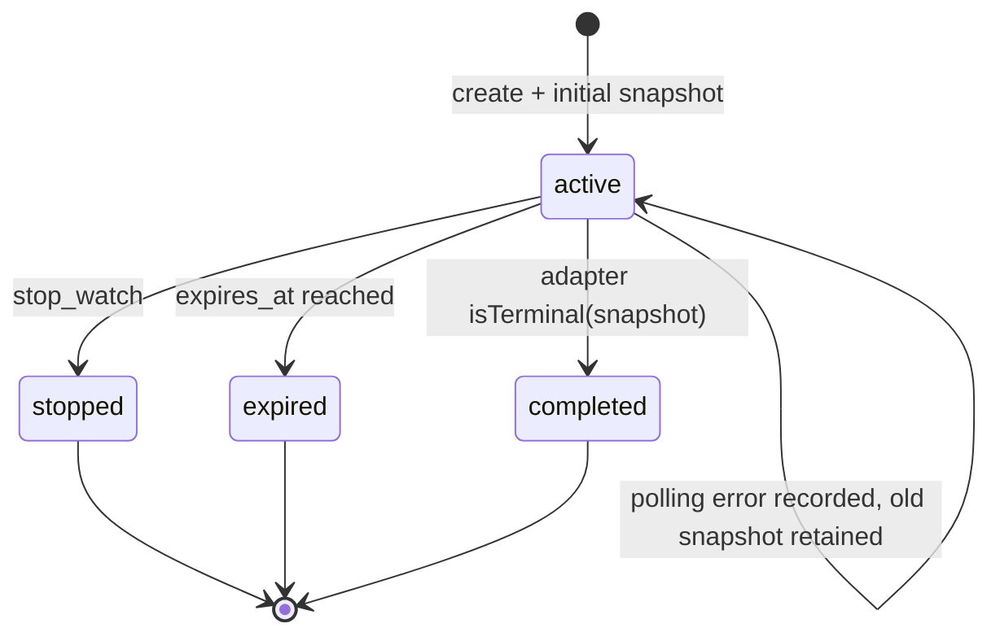

Polling iterates active watches in creation order. Unsupported adapters and
source failures are recorded in `last_error`; the previous snapshot is kept so
a later successful read still produces transitions from the last known state.
Events are enqueued before a terminal snapshot marks the watch completed, so
the final arrival/cancellation notification is not lost. Expiry is evaluated
before active watches are loaded, and each expiry is emitted as a lifecycle
event. `stop_watch` only moves an active monitor to
`stopped`, making repeated stopping non-escalating and side-effect reducing.

The train adapter maps snapshot transitions as follows:

| Event | Transition condition | Key data exposed to rules/LLM |
|---|---|---|
| `train.platform_announced` | No previous platform; current snapshot has one | Platform, programmed/effective values and confidence. |
| `train.platform_confirmed` | No previous effective platform; current snapshot has one | Confirmed platform and train identity. |
| `train.platform_changed` | Previous and current platform both exist and differ | Previous/new platform and current confidence. |
| `train.departed`, `train.arrived`, `train.cancelled` | Corresponding boolean changes from false to true | Train, segment, delay, platform and update time. |
| `train.delay_changed` | Delay minutes differ | Old and new delay. |
| `train.eta_changed` | Estimated arrival timestamp differs | Previous/new ETA and the refreshed train state. |
| `train.stop_arrived`, `train.stop_departed` | A stop gains the corresponding actual timestamp | Station ID/name/index, next stop and relative destination position. |

Train watches are terminal on cancellation or an actual arrival timestamp at the **final route stop**, not merely arrival at the requested segment destination. `train.arrived` still describes that requested destination; stopping the watch and emitting that event are different decisions.
Default expiry is two hours after scheduled arrival, or scheduled departure
when arrival is absent; if neither exists, the fallback effectively keeps the
watch for eight hours from creation.

Adding a future watchable domain requires implementing `WatchAdapter`, choosing
stable semantic event keys and registering the adapter in the host runtime.
The tool schema, SQLite queue, rule matcher, LLM handoff, Web Push delivery and
stop lifecycle remain unchanged. A good adapter must keep snapshots
serializable, make events deterministic from `(previous,current)`, provide
truthful fallback text, define a bounded expiry and identify terminal state.
Domain-specific wording belongs in `DomainEvent.notification`, not in the
generic delivery service; titles and guidance can be keyed by notification
language, while a plain guidance string remains valid for language-neutral
rules.

### LLM Gateway Request Lifecycle

Steward service calls use `apps/llm-gateway` by default, including local embeddings. Endpoint overrides, the wiki’s independent provider configuration and the offline model-replay tool can bypass it:

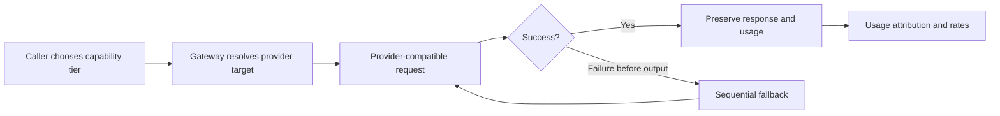

Callers choose capability, not vendor:

- the host can request `tier-5` without knowing which DeepSeek model implements it;
- background classification can choose a cheaper tier;
- embeddings default to `local-embed`, with explicit endpoint/model overrides;
- provider keys, base URLs and fallback behavior stay inside one service.

For non-streaming calls, a failed target can escalate and then sweep compatible lower paid rungs. Streaming is more constrained: the gateway can retry only before response bytes reach the client. It may fall back from a failed native stream to a non-streaming response re-emitted as synthetic SSE, but it never switches providers in the middle of visible output.

Repeated aliases for the same provider/model/host/key collapse to one target.
All targets and response bodies share `GATEWAY_REQUEST_TIMEOUT_MS` (120 seconds
by default). Separate provider-attempt diagnostics record request correlation,
status, stream mode and time to headers; they do not double-count terminal usage
or infer upstream billing for failed attempts. A committed stream ends on failure
rather than replaying through another target.

Explicit `GATEWAY_API_KEY` configuration enforces Bearer authentication on model
POST routes; unset retains local unauthenticated compatibility. Diagnostic GETs
remain public. The wiki custom provider needs the key configured separately;
internal helpers reuse a shared key only for the loopback gateway endpoint, never
implicitly for a remote endpoint override.

The gateway preserves provider usage fields and exposes code-configured rates. Callers add `x-usage-service` and `x-usage-action` so cost can be attributed to, for example, `mail-promoter / triage` instead of only “tier-5.” Missing attribution is recorded as `unknown` and surfaced in the Usage page; it is never silently dropped.

## Data Ownership And Rebuildability

Not every SQLite database has the same authority. Some are disposable indexes over Apple-owned data; others are Steward's primary operational history.

| Data | Source of truth | Steward representation | Rebuildable? |
|---|---|---|---|
| Mail messages | Apple Mail EMLX store | `mail-mirror/mail.db` | Yes, via backfill/reconcile; promotion and embedding state can be regenerated. |
| Mail attachments | EMLX/Mail.app | Content-addressed mirror blobs | Yes when the original remains available. |
| Calendar events | Apple Calendar CoreData store | `calendar-index.sqlitedb`, local identity/UID aliases | Event/search data can be rebuilt; deleting the index loses historical alias mappings. |
| Contacts | AddressBook stores | `contacts-index.sqlitedb` | Yes, via contacts index. |
| Long-term memory | Wiki Markdown sources/pages | Wiki vector and graph indexes | Markdown is primary; indexes are rebuildable, though regenerating LLM caches can cost tokens. |
| Action items | Steward analysis and user state | `action-center/actions.db` | No; status and review history are primary Steward state. |
| Write operations | Attempt/confirmation lifecycle | `write-ops/ops.db` | No; required for safe confirmation and retry. |
| Chats | User/assistant/tool transcript | `steward-chats/chats.db` and session files | No; this is primary conversation state. |
| Active watches and events | User-authored watch rules and observed event delivery state | `Steward/watches.db` | No; required for restart-safe monitoring and deduplication. |
| Usage | Gateway and tool-call accounting | `steward-usage/usage.db` | Not fully; provider history may not be available later. |
| Audit | Redacted event stream | `steward-audit/audit.db` | No; the redacted record is intentionally primary. |

This distinction guides recovery. Deleting a search index costs time and can remove local identity continuity; deleting the write journal can remove the evidence needed to decide whether a side effect should be retried.

### Backup Boundaries

Before native cutover, the operational backup includes all ten known Steward
SQLite stores: chats, watches, Audit, Usage, Actions, write journal, mail mirror,
promotion state, Calendar and Contacts indexes. Each uses SQLite's online backup
API. Agent sessions (including external session references), deployment
`config.env`, persistent Steward settings and wiki application settings are copied
alongside them. Configured path overrides in `config.env` are honored. Payload
files, temporary bridge/call state and managed code/runtime releases are separate.

```sh
npm run backup:operational -- --output=/PATH/TO/NEW/operational-backup
npm run backup:full -- --output=/PATH/TO/NEW/full-backup --wiki=/PATH/TO/VAULT
```

Full backup adds the wiki vault, external configured source directory, uploads and
Mail blobs. `--wiki` can be omitted when configured/persisted project selection
identifies the vault. The default output is a timestamped directory under
`Steward/backups/`; deployment uses `deploy/backups/RELEASE_ID/`. A manifest
records source mappings, file/database SHA-256 hashes and absent optional sources.
Directories are mode `0700`, regular files `0600`; a staging directory is renamed
to its final name only after success. Failure leaves an explicitly incomplete
`.pending-*` directory and prevents cutover. Copies preserve symlinks without
exporting their external targets; protect the resulting sensitive backup.

SQLite consistency is per database, not one global transaction. Quit writers for
a common operational point in time and stable session/content copies. Keychain,
Apple's authoritative Mail/Calendar/Contacts stores and external symlink targets
remain outside this backup. Rollback switches code and never silently restores
older state; restore is an explicit recovery operation using the manifest paths.

The wiki's optional six-hour Git backup is separate and defaults off. Before
staging or pushing, it requires an identifiable `github.com` HTTPS/SSH remote
and `gh api` verification that the repository is private; missing authentication,
public visibility or an unverifiable remote aborts the backup. Git credentials
still perform the push. Sources/pages/schema and valuable ingest/caption caches
are included; vector/transient caches and `app-state.json` are excluded. This
remote snapshot does not preserve Steward operational authority or Keychain.
Privacy can change after verification; it is not a permanent visibility guarantee.

## Failure Modes And Graceful Degradation

Steward is designed to retain narrower functionality when a dependent service is missing:

| Failure | Behavior |
|---|---|
| LLM gateway offline | Existing lexical/trigram mail search and deterministic filters still work. New embeddings, agent turns, promotion and Action Center LLM analysis wait or fail explicitly. |
| Embedding endpoint disabled | Mail, calendar and contact indexes operate in keyword-only mode. No vector results are mixed into ranking. |
| One embedding input poisons a batch | Failed members are retried individually; healthy members still advance. |
| Vector dimension changes | Incompatible vector state is reset rather than queried with mixed dimensions. |
| `.partial.emlx` body | Available text is indexed. Individual reads attempt live fallback only when the non-full mirrored body has fewer than 20 trimmed characters. |
| Mail watcher misses an event | Periodic reconcile discovers the path/mtime difference. |
| Message disappears from one Gmail mailbox | Its path is removed; the logical message survives while another path remains. |
| Full Disk Access missing | Local Apple database reads return actionable permission errors rather than silently empty results. |
| Automation permission denied | Database reads remain available when FDA is granted; AppleScript compatibility writes fail. EventKit uses its separate Calendar Full Access grant. |
| Calendar Full Access denied or bridge unavailable | EventKit reports an error/uncertain timeout; there is no blind backend switch after dispatch. The user must fix permissions/runtime and inspect uncertain effects. |
| Mail-promoter triage returns invalid JSON | The thread is deferred without terminal promotion state, so it can be retried; no malformed wiki note is committed. |
| Action Center planning fails | The scan records deferred diagnostics. Thrown planner failures remain unseen for retry; ordinary no-action outcomes are recorded in the seen ledger. |
| Wiki API unavailable | Filesystem promotion can still write sources; the final rescan is reported unavailable and must be requested later. API-backed promotion can defer on API failure. |
| No UI is attached to a gated request | Approval times out to deny. Quick Send cannot silently execute writes. |
| Mail/EventKit/AppleScript returns but the change is not observed | The operation remains unconfirmed. Mail reaches manual review without automatic resend; Calendar confirms or exhausts without replay. |
| Push subscription is expired | The dead subscription is pruned and the per-send delivery report records the failure; an all-failed watch or Action notification remains eligible for retry. The underlying chat/Action remains available in the UI. |
| ViaggiaTreno is unavailable or has no live board result | Train tools return an explicit error; existing watches retain their last snapshot and record the polling error for a later retry. |
| LLM notification generation repeatedly fails | The durable event remains pending during bounded retries, then Steward sends the adapter's deterministic fallback message. |
| Ringback preflight fails | No chat and no SIP INVITE are created. The authenticated caller receives an explicit unavailable response after one safe health-check retry. |
| Voice channel is already active | Manual callers receive `409`; watch events remain durably pending and are retried when the coordinator reports idle, including after restart. Busy is not treated as call failure and cannot trigger fallback push. |
| SIP is blocked on the direct route | If explicitly configured, a call-scoped Tailscale exit-node lease is acquired and probed for up to 20 seconds. The previous route is restored after the call or repaired from the journal after a crash. |
| Remote audio stalls after connection | Ringback emits `media_interrupted`; Steward makes at most one continuation call in the same chat. Normal hangup, silence and unanswered dialing never enter this recovery path. |
| A watch-started call fails | A push is sent only if every matched voice rule explicitly set `voiceFallback: "push"`; a call-only rule vetoes cross-channel fallback. The event is claimed before dialing and is never redialed merely because delivery restarts. |
| Action notification SQLite polling fails | The best-effort poll logs the error and releases its single-flight guard; the host, chat and unrelated services remain alive for a later poll. |
| MCP service is offline during system diagnostics | The service is marked unavailable, but its last discovered or bundled tool inventory remains visible with policy and historical usage. |
| Gateway rates unavailable | Usage display falls back to configured static rates; raw tokens remain recorded. |

This degradation model is deliberate: a missing probabilistic or remote capability should not make deterministic local data inaccessible.

## Performance, Bounding And Backpressure

Local-first does not mean unbounded. Several limits keep cold starts, model context and background work predictable:

| Area | Bound or strategy | Reason |
|---|---|---|
| Mail SQLite | WAL mode, best-effort 2 GiB mmap and 64 MiB page cache | Multiple readers can search while ingestion writes; large local archives avoid repeated cold-page reads. |
| Ranked mail search | 50 lexical + 50 vector candidates | Ranking stays fast before RRF and final filtering. |
| Train lookup | Current departure-board candidates, direct services only | Bounds live API calls and avoids pretending to be a full journey planner. |
| Watch polling | 45 s default; configured base has a 15 s floor; adapters can request urgency down to a global 5 s floor; no overlapping poll/delivery loop | Keeps ordinary polling economical while allowing time-sensitive milestones without concurrent duplicate work. |
| Voice admission | One active SIP session; 10-minute request-id idempotency; two bounded preflight attempts | Matches Ringback's process-global media state and prevents Shortcut/network retries from double-dialing. |
| Voice recovery | One network retry before answer; one media-interruption callback after connection | Repairs transient transport failures without turning recovery into an unbounded call loop. |
| Voice network readiness | SIP TLS probes every second for at most 20 s after exit-node selection | Accommodates asynchronous macOS route convergence while bounding call startup. |
| Trigram search | Up to 500 candidates per field | Substring filters drive selection without scanning all inline bodies. |
| Unranked mail browse | 500-row window; internal limit max 100, public MCP page max 12 | Supports sorting/pagination without materializing the entire archive. |
| Action-planner mail page | Up to 6 compact results; threads and large bodies expose continuation offsets | Avoids full-message context by default. |
| Action-planner calendar/contact/wiki pages | Up to 10 events, 8 contacts and 5 wiki results; wiki file pages max 5,000 characters | Keeps read-tool context proportional to the decision while allowing explicit continuation. |
| Documents | Read caps 12,000 characters/3 pages; search 10 excerpts; 256 semantic chunks; eight cached files | Bounds returned context, selected vector work, parser lifetime/heap, declared Office expansion and estimated cache bytes. |
| Action Center list | `list_actions` defaults to 20 and is capped at 100 in both MCP schema and SQLite store; full payloads are opt-in | Prevents large context snapshots from producing unbounded memory or model-context growth. |
| Mail embedding input | First 2,000 characters by default | Bounds embedding cost and latency while retaining subject and leading body context. |
| Embedding batches | 32 by default, with per-item recovery | Amortizes gateway overhead without allowing one input to poison the queue. |
| Mail promotion | Thread hashes plus worker pool; CLI concurrency 10, direct runner default 8 | Avoids unchanged work and overlaps I/O-bound model/wiki requests. |
| Action Center | Recent window 14 days, query pool 300, process limit 50 by default | Focuses background attention on new actionable mail and bounds model calls. |
| Triage bodies | Cleaned/truncated single messages; larger chronological thread representation | Prevents quoted-history explosions while preserving multi-message decisions. |
| Scheduler | Per-job timeout and no-overlap set | Applies backpressure when a prior run is still active. |

These values are implementation defaults, not architectural constants. Environment variables expose the operationally important ones, while hard candidate caps protect interactive latency. Performance changes should be measured against realistic multi-gigabyte mail databases, not only test fixtures.

### Measured Local Benchmarks

Rerun on **2026-10-14**, after the audit fixes, using
[`tools/steward-benchmark.mts`](tools/steward-benchmark.mts). The repeat pass below
completed **26 cases without errors**; an initial 25-case pass established the
same workload before adding a positive Contacts query. Both reports retain every
timing sample and aggregate result count:

- [Repeat pass, used in the tables](docs/benchmarks/2026-10-14.json).
- [Initial pass, retained for startup variability](docs/benchmarks/2026-10-14-initial.json).
- [Historical 2026-08-19 measurements](docs/benchmarks/2026-08-19.md).

#### Method And Reproduction

The system was an Apple M4 with 16 GiB RAM, arm64, macOS 26.3.1 and Node
24.13.0. The measured repository revision was `a5cc1c3`; the benchmark
harness is introduced with these results. Existing packaged services and Ollama
`bge-m3` stayed running. The gateway was measured as that already-running local
service, not rebuilt or redeployed for the run.

```sh
# SQLite/search plus disposable synthetic document fixtures; no model requests:
npm run benchmark
# Add local-embed generation, KNN and hybrid retrieval:
npm run benchmark -- --with-local-embeddings --output=/private/tmp/steward-benchmarks.json
# Portable document-only cases, without personal indexes or model requests:
npm run benchmark -- --documents-only
# Check statistics, read-only enforcement and local endpoint validation:
npm run benchmark:check
```

Default reports go to ignored `tmp/benchmarks/`. Database defaults follow Steward
paths; `BENCH_MAIL_DB`, `BENCH_CALENDAR_DB` and `BENCH_CONTACTS_DB` select alternate
existing indexes. Missing indexes are reported explicitly. Local embedding calls
require a loopback HTTP `/v1/embeddings` endpoint (`BENCH_GATEWAY_URL` override)
and use `GATEWAY_API_KEY` when configured. They send only the fixed generic query,
carry `benchmark / readonly-embedding` attribution and add ordinary gateway Usage
records. Query vectors remain in a temporary directory that is removed afterward.
No messages, names, addresses, identifiers or document excerpts enter the reports.

Each case runs sequentially in a fresh child process. SQLite connections are
`readonly`, `fileMustExist` and `query_only=ON`; no migrations or personal data
writes run. SQL cases have **31 timed operations: one first query and 30 warm
samples**. Extraction and local-embedding cases use one first operation plus ten
subsequent samples. Median excludes the first; p95 uses the nearest-rank empirical
percentile. With only ten subsequent observations, p95 is the maximum observed
sample and is descriptive, not a reliable production-tail estimate.

“First query” excludes child bootstrap, module imports, database connection and
extension loading. The OS page cache is **not flushed**, and background services
are not paused; it is not a disk-cold or full MCP startup measurement. The local
embedding model is primed by one untimed generic-vector check. Hybrid cases
explicitly warm KNN before timing to represent an established connector process.
Text queries are fixed: Mail `project`, Calendar `meeting`, Contacts `università`
and an absent `university` control. Archive counts are sampled after each pass,
not frozen in a transaction across all cases.

#### Dataset

| Index | Main SQLite file | WAL at sampling | Records | Embedding state / dimension |
|---|---:|---:|---:|---:|
| Mail mirror | 3.73 GiB | 4.60 MiB | 78,024 active messages; 45,150 thread rows; 13,857 attachment rows | 78,432 / 1,024 |
| Calendar | 13.35 MiB | 4.15 MiB | 694 indexed events | 694 / 1,024 |
| Contacts | 4.36 MiB | 0 | 771 normalized contacts | 771 / 1,024 |

Mail has 35,857 active `partial`/`none` bodies
(46.0%). Embedding-state rows are independent
from active-message counts and do not prove exact active-vector coverage. File
sizes exclude auxiliary files other than the separately reported WAL.

#### Retrieval Latency

| Operation | Returned | First query | Warm median | Warm p95 |
|---|---:|---:|---:|---:|
| Mail FTS5 candidates, cap 50 | 50 | 75.79 ms | **1.13 ms** | 1.17 ms |
| Mail subject trigram candidates, cap 500 | 412 | 81.13 ms | **2.44 ms** | 2.83 ms |
| Mail body trigram candidates, cap 500 | 500 | 35.71 ms | **4.83 ms** | 5.08 ms |
| Mail recent unread IDs, cap 20 | 20 | 54.94 ms | **15.85 ms** | 18.92 ms |
| Mail lexical search + summaries, cap 12 | 12 | 4.70 ms | **1.51 ms** | 1.63 ms |
| Mail body substring search + summaries, cap 12 | 12 | 20.87 ms | **12.29 ms** | 14.12 ms |
| Mail vector KNN, cap 50 | 50 | 8,843.00 ms | **38.49 ms** | 47.15 ms |
| Gateway `local-embed` (returned dimensions) | 1,024 | 36.77 ms | **18.55 ms** | 21.90 ms |
| Mail hybrid, precomputed query vector | 12 | 167.77 ms | **40.47 ms** | 48.33 ms |
| Mail hybrid, fresh local query embedding | 12 | 156.75 ms | **73.17 ms** | 133.20 ms |
| Calendar FTS5 candidates, cap 500 | 58 | 27.06 ms | **0.065 ms** | 0.086 ms |
| Calendar vector KNN, cap 500 | 500 | 83.45 ms | **1.80 ms** | 2.06 ms |
| Contacts FTS5 matching query, cap 200 | 10 | 3.92 ms | **0.032 ms** | 0.040 ms |
| Contacts FTS5 absent query, cap 200 | 0 | 3.82 ms | **0.017 ms** | 0.024 ms |
| Contacts vector KNN, cap 200 | 200 | 11.34 ms | **0.669 ms** | 0.759 ms |

Candidate rows measure bounded SQL retrieval without body materialization.
The lexical/substring/hybrid response rows call the current production `searchDb`
with `perMessage: true` and limit 12, including filters and summary loading but
excluding MCP transport, host wrappers and UI rendering. KNN uses a real generic
1,024-dimensional local query vector. Returned pools at their cap do not imply
that the complete corpus has only that many matches.

The precomputed-vector hybrid case isolates retrieval and fusion from query
embedding. Its warm median is 40.47 ms versus
73.17 ms with a fresh local embedding. The separate embedding median is
18.55 ms; these separately sampled distributions are not additive components
of one instrumented request. Both retrieval and model/HTTP work matter at this
archive size. Calendar/Contacts KNN are raw candidate queries, not full tool calls
or Calendar recurrence expansion.

#### Negative Lookup And First-Query Variability

The fixed absent substring is `stewardbenchmarkabsent9e7318fd`; both strategies
returned zero rows on every sample:

| Operation | Returned | First query | Warm median | Warm p95 |
|---|---:|---:|---:|---:|
| Absent body substring, trigram | 0 | 217.60 ms | **1.88 ms** | 2.03 ms |
| Absent body substring, `LIKE` scan | 0 | 653.35 ms | **326.15 ms** | 549.08 ms |

The warm median `LIKE` scan was about
173× the trigram lookup for this absent query. This
is the case where an unindexed scan cannot stop at an early positive match;
it is not a universal speedup for all substrings.

| First operation in a new process | Initial pass | Repeat pass |
|---|---:|---:|
| Recent unread IDs | 10,770.32 ms | 54.94 ms |
| Absent `LIKE` scan | 17,162.81 ms | 653.35 ms |
| Mail vector KNN | 8,057.89 ms | 8,843.00 ms |

A new process does not imply a cold filesystem cache: the unread and negative
scan first samples varied sharply between passes, while Mail KNN still incurred
roughly eight seconds on its first timed query. Warm KNN medians were about
38.49 ms in both passes. The measurements support persistent connectors and
bounded indexed retrieval, while leaving OS cache, memory pressure and background
activity as uncontrolled factors. They do not isolate the precise cause of every
first-query stall or establish a performance regression against August.

#### Document Extraction, Cache And Search

These cases use disposable generated files rather than private documents.
Extraction clears the LRU **before every sample** and includes safe-path checks,
worker startup, parsing, result transfer and cache publication. Its subsequent
samples remain uncached extractions; the separate cache case primes one extracted
document before timing. Search starts from extracted text: the first sample builds
chunks/vectors as applicable, later samples reuse them. Read timings start from
extracted text too and are not file-opening or end-to-end client latency.

| Operation | Returned | First query | Warm median | Warm p95 |
|---|---:|---:|---:|---:|
| Uncached text extraction, 100,000 chars | 100,000 | 75.44 ms | **36.40 ms** | 38.03 ms |
| Uncached text extraction, 2,000,000 chars | 2,000,000 | 41.65 ms | **38.23 ms** | 41.38 ms |
| Uncached text-layer PDF, 20 pages¹ | 911 | 845.41 ms | **365.42 ms** | 389.04 ms |
| Uncached PPTX, 20 slides¹ | 44,591 | 106.31 ms | **74.66 ms** | 75.87 ms |
| Cached extraction lookup, 2,000,000 chars | 2,000,000 | 0.047 ms | **0.021 ms** | 0.030 ms |
| Read from extracted text, default budget | 6,000 | 0.474 ms | **0.003 ms** | 0.013 ms |
| Lexical search, 65 chunks | 5 | 6.84 ms | **0.152 ms** | 0.322 ms |
| Lexical search, 1,284 chunks | 5 | 9.47 ms | **2.62 ms** | 3.45 ms |
| Fusion, 1,284 chunks / 256 synthetic vectors² | 5 | 10.79 ms | **2.63 ms** | 3.01 ms |

¹ The PDF has 6,365 input bytes and yields 911 characters across 20 text-layer
pages; PPTX has 4,403 compressed input bytes and yields 44,591 characters across
20 slides. These deliberately simple fixtures measure format initialization and
basic extraction, not scanned-PDF OCR, complex layout fidelity or every Office
feature. Text fixtures are exactly 100,000 and 2,000,000 UTF-8 ASCII bytes.

² The fusion case injects fixed 1,024-dimensional vectors through the existing
search dependency hooks. It measures chunk selection, cosine ranking and RRF,
**not embedding-model latency or relevance**. Lexical search covers all 1,284
chunks; semantic coverage is explicitly `sampled` at 256 chunks. No network
request occurs in this case. The read case returns 6,000 characters; searches
return five excerpts within the normal output budget.

The warm extracted-text lookup is below 0.1 ms, while uncached worker extraction
costs tens of milliseconds for these text/Office fixtures and hundreds for PDF.
At two million characters, cached lexical search remains a few milliseconds.
This quantifies the value of retaining extraction results without changing the
worker resource bounds. These are point-in-time measurements; the August report
uses different archive sizes, queries and an unretained harness, so numerical
changes must not be presented as a controlled before/after improvement.

## Trust Boundaries And Threat Model

Steward assumes model output, email content, document content and tool arguments can all be wrong or adversarial. It does not assume that a strong prompt is a security boundary.

### Authority Boundaries

| Boundary | Enforcement |
|---|---|
| Model → tools | Host-side allow/gate/deny policy wraps every tool definition. |
| Read → sensitive operation | Known safe operations are allow-listed; unlisted interactive tools are gated by default. Background jobs and pre-authorized watches have their own configured authority. |
| Proposed → authorized arguments | Approve-with-edit can replace model-generated input before execution. |
| Attempted → confirmed side effect | Write journal plus mirror/index confirmation. |
| Filesystem discovery → mutation | Separate read/write tools and sensitive-path guards. |
| Host → model provider | Default gateway isolates provider credentials and routing; endpoint overrides and wiki provider settings are separate configuration boundaries. |
| Browser → local data | Auth token on WebSocket/data routes; tokenized file registry instead of arbitrary paths. |
| Spoken response → tool execution | Host-owned exact-command parser resolves the original pending approval; the agent never interprets its own authorization. |
| Watch rule → future side effect | Registered capability schema, exact/template/set/range/relative-time constraints, rule-scoped tool exposure and durable invocation claims. |
| Steward → system network route | Call-scoped journaled lease restores the previous Tailscale route and refuses to overwrite a later manual route choice. |
| Event payload → persisted audit | Bounded heuristic redaction precedes payload insertion; summary/source strings are redacted too; audit writes are best-effort. |

An email can contain text that tries to instruct the agent to send data or run a command. That content may influence the model's reasoning, but it cannot change `tool-policy.ts`, approve its own write or turn a denied tool into an allowed one. The user still needs to assess the proposed action and recipient.

The model can also produce a factually wrong answer without calling a dangerous tool. Steward mitigates this with visible tool calls, source links and inspectable memory; it does not claim to make model reasoning infallible.

### What The Security Model Does Not Promise

- A user-approved harmful action is still authorized, including a harmful argument constrained in a future watch grant.
- Full Disk Access gives the Steward process broad read capability; OS account security remains important.
- A configured remote model provider receives the prompt/context sent through the gateway.
- Tailscale/private HTTPS reduces exposure but does not replace token hygiene.
- Local SQLite and Markdown stores are not encrypted by Steward; disk encryption and macOS account protection remain the storage boundary.
- Audit payload redaction is heuristic and best-effort. Primary transcripts/journals retain operational text; unrecognized sensitive prose can survive audit heuristics. It does not control what configured external services receive.

## Engineering Decisions And Trade-Offs

### Why Mirror Apple Mail Instead Of Searching Through AppleScript?

AppleScript is useful for targeted live reads and authorized writes, but it is slow and awkward for large ranked searches. A local mirror provides predictable SQL queries, offline search, thread reconstruction, trigram indexing and embeddings. Reconciliation absorbs the complexity of keeping that mirror current.

### Why SQLite?

The data is single-user, local and moderate in scale. SQLite keeps deployment self-contained, supports transactions and FTS5, and works with sqlite-vec in the same process. Separate databases also give each service ownership of its schema and failure domain without requiring a database daemon.

### Why FTS, Trigrams And Vectors?

No one retrieval method dominates:

- FTS is precise and cheap for words that appear in the source.
- Trigrams make substring filters fast and predictable.
- vectors recover semantically related text with different vocabulary.
- deterministic SQL handles dates, flags, mailboxes and identities.

RRF combines rankings without pretending their raw scores are comparable.

### Why Distill Whole Threads?

Decisions and commitments often emerge across replies. Per-message notes duplicate context and can preserve obsolete intermediate states. One canonical thread note captures the current conversation while retaining all source message IDs.

### Why Markdown Memory?

Markdown makes memory inspectable, editable, portable and versionable. YAML frontmatter preserves machine-readable provenance; wikilinks and graphs add structure without hiding knowledge in a proprietary database.

### Why One Triage And Distillation Call?

The original economic reason for a cheap classifier followed by an expensive distiller disappears when one capable low-cost model can do both. A single structured call reduces latency, token duplication and failure points. Deterministic prefilters still remove obvious noise before the model.

### Why Capability Tiers?

Callers express required capability while the gateway owns provider choice. This allows model migrations, local/paid routing, fallback and cost accounting without changing every application.

### Why Confirm Writes Against Mirrors?

A successful AppleScript/EventKit return is not the same as an observed source-system effect. Confirmation adds mirror evidence before marking the operation confirmed. Its matching/freshness limitations remain explicit; Sent-folder evidence does not prove transport delivery, and native rule/occurrence evidence does not prove every future instance.

### Why Is Policy Outside The Prompt?

Prompts are probabilistic instructions to a model. Authorization must be deterministic application code that the model cannot rewrite, ignore or reinterpret.

### Why Keep Wiki Promotion And Action Center Separate?

Durability and urgency are orthogonal. A passport or long-term decision belongs in memory but may need no action; a routine scheduling request may need action but is not durable knowledge. Separate pipelines let each use its own state, thresholds and lifecycle.

### Why Is Voice A Channel Instead Of A Separate Agent?

Phone audio changes transport and turn-taking, not authority or memory. Reusing
`ChatManager` keeps the same persisted conversation, MCP tools, policy wrappers,
Usage attribution and Audit semantics. A transport-neutral coordinator lets a
future streaming implementation replace Ringback without changing `/voice/*`
or creating a second security model.

### Why Are Call Retries Split By Failure Phase?

A pre-answer network failure has not yet delivered speech and can safely try one
alternate route. A connected media interruption is different: the user may have
heard only part of the turn or approved nothing. Its recovery must preserve the
chat, re-establish conversational position and refuse to replay external effects.
No-answer and normal hangup are user outcomes, not infrastructure retries.

### Why Immutable Native Releases Instead Of Updating In Place?

The app bundle and Ringback runtime contain compiled, architecture-sensitive
dependencies. Building a complete candidate beside the active release makes
verification and rollback meaningful and avoids half-updated processes. User
state remains external, while pre-cutover SQLite snapshots provide recovery
evidence without pretending that rolling code back should also erase newer data.

## Extending Steward Safely

Adding a connector is more than registering an MCP server. A complete integration should:

1. Define typed read and write tools with narrow schemas.
2. Keep source-system reads separate from side effects.
3. Add read tools explicitly to `tool-policy.ts`; leave writes gated or explicitly deny them.
4. Validate identifiers, paths, recipients and date ranges inside the connector.
5. Return stable structured results suitable for UI cards and agent follow-up.
6. Attribute gateway calls with service/action headers.
7. Emit redacted audit events for meaningful operations.
8. Journal and confirm non-idempotent writes when the source system permits observation.
9. Expose health/status diagnostics.
10. Add unit tests for parsers, filtering, policy behavior, error mapping and edge cases.
11. Add a live test separately and keep it out of CI if it touches personal data.
12. Document permissions, source of truth, rebuildability and graceful-degradation behavior.

For a new client/channel, implement `packages/protocol` rather than reaching into Pi or MCP directly. The host should remain the single authority for sessions, tool policy, approvals and data-route authentication.

## Components

| Path | Purpose |
|---|---|
| [apps/web](apps/web/) | React + Vite + PWA UI. Provides chat, chat list, mobile layout, Action Center with persistent filters and visible/total diagnostics, approval/question cards, tool cards, rich cards, file uploads/chips, audio recording, Usage page, Audit page, live System/tool diagnostics, voice/network settings and preview, phone pairing, notification controls and service worker. |
| [apps/host](apps/host/) | Node host on `:4317`. Serves the built UI, owns WebSocket and voice sessions, returns structured headless-turn results, runs Pi sessions including durable watch-event continuations, loads MCP tools, applies policy and spoken approvals, stores chats, records usage, handles files/auth/pairing/push/transcription, coordinates Ringback/recovery/network leases, builds system status and owns the audit ledger. |
| [packages/protocol](packages/protocol/) | Dependency-free event contract between host and clients. Keeps chat, approvals, questions, tool calls, files and Action Center state portable across future clients. |
| [packages/mcp-bridge](packages/mcp-bridge/) | Converts stdio MCP servers into Pi custom tools named like `mcp__server__tool`. |
| [apps/llm-gateway](apps/llm-gateway/) | Local OpenAI-compatible gateway on `:4000`. Provides `tier-1` through `tier-6`, `local-embed`, `/rates`, `/health`, `/v1/models`, chat completions and embeddings. Routes to Ollama and DeepSeek by default. |
| [apps/llm-wiki](apps/llm-wiki/) | Vendored LLM Wiki desktop app and MCP server. Provides persistent Markdown memory, ingest, search, graph, lint, review, Deep Research and local API. |
| [apps/mail-mirror](apps/mail-mirror/) | Local SQLite mirror of Apple Mail. Handles backfill, watch, reconcile, embeddings, thread resolution, mailbox roles, partial-message fallback and attachment blobs. |
| [apps/mail-mcp](apps/mail-mcp/) | Mail MCP connector. Searches, reads, resolves threads, opens mail URLs, saves attachments and performs approved send/reply/scheduled-send through AppleScript and write journaling. |
| [apps/mail-promoter](apps/mail-promoter/) | Mail-to-wiki pipeline. Triage, distillation, note generation, selected attachment sync and promotion state. |
| [apps/action-center](apps/action-center/) | Scans recent mail into actionable items with LLM-prepared proposals. Exposes bounded CLI/MCP list and detail surfaces, filter-aware counts, and persists status in SQLite. |
| [apps/calendar-mcp](apps/calendar-mcp/) | Calendar connector. Reads Apple data, maintains hybrid search and UID aliases, dispatches approved EventKit/AppleScript writes and journals them for confirmation. |
| [apps/contacts-mcp](apps/contacts-mcp/) | Contacts connector. Reads AddressBook data, deduplicates, labels, indexes and resolves recipients. |
| [apps/documents-mcp](apps/documents-mcp/) | Read-only document connector. Extracts common text/PDF/Office formats and provides bounded cursor reads plus hybrid lexical/semantic search. |
| [apps/shell-mcp](apps/shell-mcp/) | Safe shell/files connector. Finds files, runs constrained read-only commands, and gates write commands. |
| [apps/train-mcp](apps/train-mcp/) | Read-only live Italian train connector. Resolves dictated station names, finds the next direct service and refreshes route, delay and platform state through an opaque `trainRef`. |
| [apps/scheduler](apps/scheduler/) | Background daemon. Runs periodic CLI jobs with no-overlap scheduling, timeouts and isolated errors. |
| [packages/watch-engine](packages/watch-engine/) | Generic persistent event-monitor engine. Stores resource snapshots and rules, matches semantic adapter events, deduplicates them and maintains a durable delivery queue. |
| [packages/write-ops](packages/write-ops/) | Executable journal for mail send/reply/scheduling and Calendar CRUD. Mail uses confirmation/manual review; Calendar uses confirmation/exhaustion. Neither automatically re-executes uncertain writes. |
| [packages/audit-log](packages/audit-log/) | Shared, redacted SQLite audit ledger used by the host, write-ops, action-center and mail-promoter; queried by the host's `/audit` endpoint and the web Audit page. |
| [packages/usage-ledger](packages/usage-ledger/) | Per-turn usage ledger. Stores tokens, cost, per-tier cost attribution and tool timings/errors for the Usage page. |
| [packages/embedding](packages/embedding/) | Shared embedding client with batching and retry. |
| [packages/search](packages/search/) | Shared hybrid-search helpers: reciprocal rank fusion and sqlite-vec vector store primitives. |
| [packages/applescript](packages/applescript/) | Shared `osascript` runner with escaping, timeouts and transient-error handling. |
| [packages/source-collision](packages/source-collision/) | Shared pure/Node collision decisions: skip identical bytes, update tracked sources, rename unrelated same-name content. Used by wiki import paths. |
| [packages/sensitive-path](packages/sensitive-path/) | Shared path guard for secrets and sensitive filesystem locations. |
| [apps/wiki-add](apps/wiki-add/) | CLI and Finder Quick Actions for adding files/folders to LLM Wiki sources. |
| [apps/mac-launcher](apps/mac-launcher/) | SwiftPM menu-bar app. Opens a WebKit window behind a localized native startup/status overlay, registers `Command+Shift+Space`, checks/starts services, packages a self-contained `.app`, and reads production overrides from `~/Library/Application Support/Steward/config.env`. |
| [tools/run-ringback-managed.sh](tools/run-ringback-managed.sh) and Ringback patches | External native SIP/MCP lifecycle boundary. Pins and diagnoses the runtime, preserves stdio, localizes STT/TTS, emits structured SIP/media failures, confirms remote hangup and detects stalled RTP. |
| [tools/steward-deploy.mjs](tools/steward-deploy.mjs) | Apple Silicon installer/updater. Builds immutable app and Ringback releases, verifies architecture/checksums, snapshots primary SQLite stores, performs health-checked cutover and rolls the app symlink back without discarding newer user data. |

## LLM Gateway And Models

Steward services default to the same local gateway. Wiki providers and explicitly overridden endpoints can route independently.

The public model names are capability tiers:

- `tier-1` — local Ollama chat model, useful as the weakest/local rung.
- `tier-2` to `tier-5` — DeepSeek V4 Flash by default.
- `tier-6` — DeepSeek V4 Pro by default.
- `local-embed` — local embedding model, normally Ollama `bge-m3`.

Callers choose a tier. The gateway maps that tier to real providers. Non-streaming requests can fall back across tiers on failure. Streaming requests retry only before bytes are emitted. Usage and rates are exposed so the host can show cost in the Usage page.

## Ports And Endpoints

| Port | Service |
|---|---|
| `4317` | Steward host HTTP on localhost. WebSocket protocol, static web app, `/health`, `/upload`, `/usage`, `/audit`, `/file/<token>`, `/resolve`, `/system/*`, `/settings/notification-lang`, `/push/*`, `/quick-send`, `/quick-call`, `/voice/*`, `/transcribe`. |
| `4318` | Optional Steward HTTPS listener for phone/Tailscale when `STEWARD_TLS_CERT` and `STEWARD_TLS_KEY` are set; override with `STEWARD_TLS_PORT`. |
| `4000` | LLM gateway. `/v1/chat/completions`, `/v1/embeddings`, `/v1/models`, `/rates`, `/health`. |
| `11434` | Ollama. Used for local embeddings and optional local chat. |
| `19828` | LLM Wiki local API. |
| `5173` | Vite dev server for `apps/web`. |

By default, host and gateway are local-only. Phone access is opt-in and uses the host's HTTPS listener over a private network such as Tailscale.

## Data On Disk

Most Steward data lives under `~/Library/Application Support/`:

| Location | Contents |
|---|---|
| `Steward/auth-token` | Shared token for authenticated host routes and paired clients. |
| `Steward/vapid.json` | Persisted VAPID keys for Web Push. |
| `Steward/push-subscriptions.json` | Registered browser/PWA push subscriptions. |
| `Steward/config.env` | Packaged launcher/service overrides and secrets. |
| `Steward/voice-settings.json` | Default speech rate and independent installed voice selection for each supported language; mode `0600`. |
| `Steward/voice-call-settings.json` | Ephemeral per-call speech-rate override; cleared at call start/end. |
| `Steward/voice-network.json` | User-selected call-only Tailscale fallback and stable exit-node peer ID. |
| `Steward/voice-network.json.journal` | Write-ahead record of a temporary route change; normally absent and consumed during release/startup recovery. |
| `Steward/watches.db` | Persistent watch definitions, snapshots, aggregated event queue, rule participation and action claims. |
| `Steward/calendar-bridge/` | Launcher EventKit IPC requests, processing claims and responses; timeout does not imply cancellation. |
| `mail-mirror/mail.db` and `mail-mirror/blobs/` | Mirrored mail messages, threads, indexes, embedding state and attachment blobs. |
| `mail-promoter/` | Mail promotion state and note tracking. |
| `action-center/actions.db` | Action items, explicit reusable flows, seen ledger and scan metadata. |
| `steward/calendar-index.sqlitedb` | Calendar search index. |
| `steward/contacts-index.sqlitedb` | Contacts search index. |
| `write-ops/ops.db` | Executable Mail/Calendar inputs, scheduled sends, backend results and confirmation/retry status; sensitive primary state. |
| `steward-chats/chats.db` | Chat list and transcripts. |
| `steward-chats/` session files | Per-chat agent session state. |
| `steward-usage/usage.db` | Token/cost/tool usage ledger. |
| `steward-audit/audit.db` | Redacted audit trail of chat, tool, approval, write-op and Action Center events. |
| `steward-uploads/` | Files uploaded through the web UI. |
| `Steward/ringback/` or managed release path | External Ringback source/runtime, non-secret SIP configuration, pinned manifest and process lock. SIP password remains in macOS Keychain service `com.steward.ringback.sip`. |
| `Steward/deploy/` | Immutable releases, active/previous release metadata, deployment lock and pre-cutover SQLite snapshots. |

Read sources include:

- `~/Library/Mail` for Apple Mail `.emlx` files;
- `~/Library/Group Containers/group.com.apple.calendar/Calendar.sqlitedb`;
- `~/Library/Application Support/AddressBook`;
- the chosen LLM Wiki project directory;
- user-selected local files/folders.

On macOS these require the right privacy permissions. The process running Steward needs Full Disk Access for local data reads. EventKit writes require Calendar Full Access; AppleScript writes require Automation for Mail, Calendar and Contacts.

## Background Jobs

`apps/scheduler` is a thin orchestrator that shells out to existing app CLIs.

| Job | Default interval | What it does |
|---|---:|---|
| `mail-reconcile` | 10 min | Ingest new/changed/deleted Apple Mail `.emlx` files into the mirror. |
| `write-ops-mail` | 10 min | Confirm mail writes against the mirror or require explicit manual review; never automatically resend. |
| `write-ops-send-due` | 2 min | Send scheduled emails whose time has arrived. |
| `mail-embed` | 15 min | Embed mirrored mail that does not yet have vectors. |
| `mail-distill` | 15 min | Run mail-promoter to triage and distill new threads into wiki notes. |
| `calendar-sync` | 10 min | Rebuild/update the calendar search index. |
| `write-ops-calendar` | 10 min | Confirm calendar writes against the index. |
| `action-center` | 10 min | Scan mail into Action Center items with proposed steps. |

Intervals are controlled by `SCHED_*_MIN` environment variables. Scheduler logs default to `~/Library/Logs/Steward/scheduler.jsonl` in the packaged flow.

## Security Model

Steward is designed so trust is structural, not based on the model behaving perfectly.

- **Default-gated interactive tools** — [apps/host/src/core/tool-policy.ts](apps/host/src/core/tool-policy.ts) applies exact rules, then deny prefixes, then the `gate` default. Known safe tools are allow-listed; explicitly denied tools never run. Watch turns additionally use a deny-by-default grant policy.
- **Human approval for sensitive interactive tools** — the host requires approval; an explicitly approved agent watch can later execute only its constrained grants. Background indexing and promotion follow their configured automation rules.
- **Host-owned spoken approval** — phone approvals use exact localized commands against the original pending request; ambiguous speech fails closed and the agent never interprets consent.
- **Scoped future authority** — automatic watch actions are limited to registered capabilities, constrained arguments, matched rules and durable invocation counts.
- **Write journal** — mail/calendar writes are recorded before execution and checked against local mirrors; Calendar uses EventKit or AppleScript. Shell, Contacts and wiki writes do not share this confirmation state machine.
- **Audit trail** — [packages/audit-log](packages/audit-log/) records events best-effort with bounded payload redaction. It is distinct from full chat and operational data storage, and does not guarantee detection of every secret in arbitrary text.
- **No raw shell** — shell-like commands are parsed and executed with explicit binaries/argv. Dangerous shell features are rejected.
- **Sensitive path blocking** — path guards protect secrets such as `.env`, SSH keys and other private locations.
- **Token-gated data routes** — data HTTP routes and WebSocket connections require the host auth token.
- **Local-first services** — host/gateway default to local listeners. Mobile access is opt-in.
- **Opaque file serving** — files are exposed to the UI through registered tokens, not arbitrary open paths.
- **Provider routing** — host model calls use the gateway by default. Setting `GATEWAY_API_KEY` on the gateway enforces bearer authentication on model POST routes. Without it, loopback compatibility mode remains unauthenticated. Diagnostic GET routes remain public. Wiki providers can be configured independently.
- **External voice credentials** — the SIP password lives in macOS Keychain, not Ringback's environment file, command line or Steward release directories.
- **Reversible network fallback** — a write-ahead lease limits Tailscale exit-node changes to a call and preserves later manual route choices.

## Setup

### Prerequisites

- macOS; the Swift launcher requires macOS 14 or newer. Managed native deployment targets Apple Silicon.
- Node.js **22.19 or newer** for the current Pi dependency (the Vite toolchain also has a newer minimum than generic Node 20).
- npm.
- Xcode Command Line Tools for the Swift launcher/package flow.
- Ollama with required local models:

```sh
ollama pull bge-m3
ollama pull llama3.2:1b
```

- A DeepSeek API key for paid tiers, placed in `apps/llm-gateway/.env` using [apps/llm-gateway/.env.example](apps/llm-gateway/.env.example).
- Optional per-project overrides (e.g. Whisper language) go in `apps/host/.env`, same convention — see [apps/host/.env.example](apps/host/.env.example).
- Full Disk Access for the terminal, launcher or packaged app running Steward.
- Calendar Full Access for launcher-backed EventKit writes; Automation for Mail/Contacts and Calendar’s AppleScript compatibility path. Full Disk Access remains separately required for direct local database reads.
- Optional phone calls require Linphone/SIP, native ARM Homebrew at
  `/opt/homebrew`, and the external Ringback setup described in
  [Voice calls](docs/voice-calls.md). Docker remains an explicit fallback, not
  an automatic runtime dependency.

### Development Run

```sh
npm ci

# The vendored wiki has its own frontend lockfile/toolchain.
npm ci --prefix apps/llm-wiki

# Build the entrypoint that the host uses for wiki MCP.
npm run mcp:build -w llm-wiki

# Start the model gateway.
npm run dev -w @steward/llm-gateway

# Start the LLM Wiki desktop app separately.
# Its MCP server talks to the local LLM Wiki API.

# Start the host.
npm run dev -w @steward/host

# Start the web UI with an explicit host WebSocket URL.
VITE_HOST_URL=ws://127.0.0.1:4317 npm run dev -w @steward/web
```

Run these long-lived services in separate terminals. Start the wiki desktop runtime with `npm run tauri -w llm-wiki -- dev` when developing it; that path also needs Rust and the Tauri build prerequisites. In wiki Settings → API + MCP, enable the local API and MCP access and configure an API token. Pass the matching `LLM_WIKI_API_TOKEN` to the host and scheduler, separately from `STEWARD_AUTH_TOKEN`. Opting into unauthenticated wiki access is an alternative explicit local configuration, not the default.

Configure the wiki’s chat/embedding providers separately if its model work should use Steward’s gateway. Enabling MCP alone does not reroute wiki providers.

Then open `http://localhost:5173` and pair with the host token. Vite does not inject that token; the host-served UI auto-pairs loopback clients. Set `VITE_HOST_URL` before starting/building Vite; without it, the client targets the page’s own origin. Use the System pairing UI or enter the token locally; do not commit token values into frontend build configuration.

One-time mail bootstrap:

```sh
node --import tsx apps/mail-mirror/src/cli.ts backfill
node --import tsx apps/mail-mirror/src/cli.ts migrate
```

Background scheduler:

```sh
npm run start -w @steward/scheduler
```

### Host-Served Web UI

Build the web UI and let the host serve it from `http://127.0.0.1:4317`:

```sh
npm run build -w @steward/web
npm run dev -w @steward/host
```

### macOS Launcher

Run the native menu-bar launcher:

```sh
npm run launcher:mac
```

The launcher:

- opens the Steward web UI in a WebKit window;
- lives in the menu bar;
- registers `Command+Shift+Space`;
- starts Ollama when possible;
- checks for `bge-m3`;
- starts the gateway and host if needed;
- uses Vite during development when no built web UI exists; configure its host URL and pair the browser as described above.
- supervises only services it starts itself; already-running external services are not adopted.
- runs the private Calendar EventKit bridge and guides packaged-app privacy onboarding.

### Packaged App

Build a self-contained local app bundle:

```sh
npm run package:mac
open "dist/mac/Steward.app"
```

The bundle includes:

- Swift launcher;
- built web UI;
- compiled service entrypoints;
- Node runtime;
- required native dependencies such as `better-sqlite3` and `sqlite-vec`;
- bundled speech runtime files when present, with the Whisper model checksum
  verified during packaging;
- the live train MCP connector and generic watch engine used by the host.

Ringback is installed beside releases under Steward's Application Support
directory rather than copied into the application bundle. This keeps its
pjproject/pjsua2 licensing and native runtime boundary explicit while still
letting the deployment workflow pin, verify and roll it back with the app.

Production overrides and secrets go in:

```text
~/Library/Application Support/Steward/config.env
```

Logs go in:

```text
~/Library/Logs/Steward/
```

### Reproducible Native Installation And Updates

The production deployment workflow targets Apple Silicon and uses immutable
release directories under
`~/Library/Application Support/Steward/deploy/releases/`. `/Applications/Steward.app`
is the active symlink; mutable chats, watches, settings, logs, uploads, ledgers
and Keychain credentials remain outside every release.

```sh
# Inspect ARM Homebrew, Node/npm, app/Ringback state and prerequisites.
npm run deploy:doctor

# First native install; omit voice with --no-voice.
npm run deploy:install -- --sip-user=YOUR_LINPHONE_NAME

# Build, verify, cut over, smoke-test and retain the previous release.
npm run deploy:update

# Verify the active installation or return to the previous release.
npm run deploy:verify
npm run deploy:rollback
```

Installation uses the lockfile, builds a self-contained app, creates a distinct
Ringback/pjproject runtime, stores the SIP password in Keychain and validates
architecture, bundle layout, runtime manifest, pjsua2 import and the pinned
Whisper model SHA-256 before cutover. Updating copies only the non-secret SIP
identity. `--stage-only` can do expensive build work while Steward runs;
activation refuses to switch while an existing host still responds.

Cutover first creates SQLite-consistent backups of chats, watches, Audit, Usage
and Action Center under `deploy/backups/<release-id>/` and copies `config.env`, then changes the app
symlink atomically and launches the candidate. If its health smoke test fails,
the deployer asks it to quit, waits for the host to stop and rolls the symlink
back. The first managed install preserves an existing ordinary app bundle as a
legacy release. Rollback intentionally does not restore data snapshots, because
that would erase conversations and events created after the update; database
migrations must therefore remain backward-compatible unless an explicit data
recovery is planned. Operational snapshots include all known Steward databases, sessions and persistent settings. Wiki content, uploads and blobs require the separate full backup; Keychain remains external. See [Backup boundaries](#backup-boundaries).

A weekly ARM macOS workflow rehearses a clean package, install, update and
rollback without SIP credentials. CI proves build/deployment mechanics, not
real Linphone reachability, Tailscale routing or macOS privacy prompts; those
remain release checks on the target devices. See
[Native installation and updates](docs/native-deployment.md).

### Launcher Supervision And Privacy Onboarding

The launcher owns only processes it starts. It checks for existing Ollama,
gateway and host services; an externally running instance remains externally
managed. Managed children are restarted on exit with exponential delays of
1, 2, 4, … seconds, capped at 60. A runtime of at least 60 seconds resets that
exit-backoff history. Services with an HTTP endpoint are checked every 15 seconds
after their initial grace period; three consecutive failures terminate the
managed process, with a five-second forced-stop fallback. The scheduler has no
HTTP endpoint and is monitored by process exit only. Liveness is not proof that
every scheduled job or MCP connector is healthy.

Intentional quit cancels supervision timers and pending restart work, stops the
Calendar bridge and terminates managed children. Closing the WebKit window only
hides it; it does not stop background work. The localized startup overlay and
the System page serve different purposes: launch progress versus runtime
service/tool diagnostics.

Packaged startup proactively requests EventKit Full Access and offers a one-time
Full Disk Access explanation/deep link. The user must enable FDA manually and
restart as needed; displaying onboarding does not verify permission was granted.
Standalone development processes do not inherit the packaged app’s privacy
identity. Calendar’s AppleScript fallback still needs Automation permission,
separately from EventKit access. Logs remain under `~/Library/Logs/Steward/`.

## Important Environment Variables

| Variable | Purpose |
|---|---|
| `HOST_PORT` | Host port, default `4317`. |
| `HOST_ALLOWED_ORIGINS` | Extra allowed browser origins. Same-origin host requests are accepted automatically. |
| `STEWARD_AUTH_TOKEN` | Override persisted auth token. |
| `STEWARD_TLS_CERT` / `STEWARD_TLS_KEY` | Enable optional HTTPS listener for phone/Tailscale access. |
| `STEWARD_TLS_PORT` | HTTPS listener port, default `HOST_PORT + 1`. |
| `GATEWAY_BASE_URL` | Host-to-gateway base URL, default `http://127.0.0.1:4000/v1`. |
| `HOST_TIER` | Agent model tier, default `tier-5`. |
| `GATEWAY_API_KEY` | Shared model-route bearer key when explicitly configured on gateway and callers; unset gateway retains unauthenticated loopback compatibility. Host client fallback is `sk-local`. |
| `DEEPSEEK_API_KEY` | Gateway provider key for paid tiers. |
| `GATEWAY_PORT` | Gateway port, default `4000`. |
| `GATEWAY_REQUEST_TIMEOUT_MS` | Shared upstream request/body deadline across fallback attempts, default `120000` ms. |
| `MAIL_EMBED_ENDPOINT` | Mail embedding endpoint; defaults to gateway, set `off` to disable. |
| `MAIL_CLASSIFY_ENDPOINT` | Mail role classification endpoint; defaults to gateway, set `off` to disable. |
| `MAIL_PROMOTER_LLM_ENDPOINT` | Full chat-completions endpoint; defaults to `http://127.0.0.1:4000/v1/chat/completions`. |
| `MAIL_PROMOTER_CONCURRENCY` | Backfill CLI workers, default `10`; direct `runBatch()` default is `8`. |
| `APPROVAL_TIMEOUT_MS` | Approval timeout for gated actions, default `300000` ms. |
| `VITE_HOST_URL` | Build/dev-time web WebSocket URL override; use `ws://127.0.0.1:4317` with Vite. |
| `LLM_WIKI_API_BASE_URL` / `LLM_WIKI_API_TOKEN` | Independent wiki API endpoint/token for MCP and API clients; default base `http://127.0.0.1:19828`. |
| `STEWARD_CALENDAR_BRIDGE_DIR` | Private launcher bridge root passed to its child services; setting it alone does not start a bridge. |
| `ACTION_CENTER_CALENDAR_DAYS` | Calendar reminder lookahead, default `3` days. |
| `CALENDAR_INDEX_DB` / `CONTACTS_INDEX_DB` | Override the respective local search index paths. |
| `DOCUMENT_MAX_BYTES` / `DOCUMENT_EXTRACT_TIMEOUT_MS` | Document input size and extraction wait limits; defaults 25 MiB and 15 s. |
| `DOCUMENT_EMBED_ENDPOINT` / `DOCUMENT_EMBED_MODEL` / `DOCUMENT_EMBED_API_KEY` / `DOCUMENT_EMBED_DIM` | Independent document embedding overrides; endpoint `off` disables semantics. |
| `DOCUMENT_WORKER_HEAP_MB` / `DOCUMENT_MAX_EXTRACTED_CHARS` | Parser V8 old heap (256 MiB) and output character budget (8 million). |
| `DOCUMENT_ARCHIVE_MAX_BYTES` / `DOCUMENT_CACHE_MAX_BYTES` | Declared Office expansion and estimated aggregate cache budgets; each defaults to 64 MiB, capped at 256 MiB. |
| `WRITE_OP_MAIL_MAX_CONFIRM_ATTEMPTS` / `WRITE_OP_CALENDAR_MAX_CONFIRM_ATTEMPTS` | Confirmation limits, each default `12`; Mail then requires review and neither domain automatically re-executes writes. |
| `STEWARD_PUSH_CONTACT` | VAPID contact URI for Web Push. |
| `STEWARD_WHISPER_BIN` | Path to `whisper.cpp` binary for transcription. |
| `STEWARD_WHISPER_MODEL` | Path to local Whisper model file. |
| `STEWARD_SPEECH_LANGUAGE` | Whisper language code, default `en`; set `it` explicitly for Italian dictation. |
| `STEWARD_SPEECH_ENABLED` | Set `0` to disable transcription. |
| `STEWARD_VOICE_TRANSPORT` | Optional voice transport: `ringback`; `streamcore` is reserved for the future adapter. |
| `STEWARD_RINGBACK_LAUNCHER` | Absolute path to Ringback's Steward-managed MCP launcher. |
| `STEWARD_VOICE_OPENING_LINE` | Default first sentence spoken when `/voice/call` starts. |
| `STEWARD_VOICE_PREFLIGHT_TIMEOUT_MS` | Timeout for MCP startup/tool discovery and the safe Ringback status probe; default `10000`, minimum `1000`. |
| `STEWARD_VOICE_SETTINGS_FILE` | Optional override for persisted default speech rate and voice; normally managed from System settings. |
| `STEWARD_VOICE_CALL_SETTINGS_FILE` | Optional override for the ephemeral per-call speech-rate file. |
| `STEWARD_VOICE_NETWORK_SETTINGS_FILE` | Optional override for persisted call-network fallback settings and its adjacent recovery journal. |
| `STEWARD_VOICE_EXIT_NODE_ID` | Stable Tailscale peer ID for the call-scoped SIP fallback; overrides the saved peer selection without hard-coding its current IP. |
| `STEWARD_STREAMCORE_URL` | Reserved base URL for the future StreamCore adapter. |
| `TRAIN_MCP_ENTRY` | Override the train MCP entrypoint; normally set automatically by the packaged launcher. |
| `VIAGGIATRENO_BASE_URL` | Override the ViaggiaTreno endpoint, primarily for testing or a compatible proxy. |
| `WATCH_DB` | Override the generic watch SQLite path; defaults to `Steward/watches.db`. |
| `WATCH_POLL_MS` | Watch polling interval, default `45000` ms with a 15-second minimum. |
| `SCHED_*_MIN` | Override scheduler intervals. |
| `LLM_WIKI_BUNDLED_SERVICES` / `STEWARD_BUNDLED_SERVICES` | Tell services they are running from the packaged bundle. |

## Development Notes

- Workspaces use TypeScript ESM.
- Most CLIs run with `node --import tsx`.
- Tests use Node's built-in test runner or Vitest depending on the app.
- Run tests only where a `test` script exists: e.g. `npm test -w @steward/host`. Web and MCP bridge do not currently expose that script; host tests cover bridge behavior. Web’s pure helper tests can be run with `node --import tsx --test apps/web/test/*.test.ts`.
- Run a workspace typecheck where available, e.g. `npm run typecheck -w @steward/host`.
- `npm run build:web-host` builds the web UI and typechecks the host.
- The LLM Wiki fork has its own Vite/Tauri/Vitest toolchain under [apps/llm-wiki](apps/llm-wiki/). Use `npm run test:mocks -w llm-wiki` for its deterministic frontend suite; its generic `npm test` also runs opt-in real-LLM tests.

Train and watch verification is split between deterministic tests and an
explicit live smoke flow:

```sh
# Fuzzy station resolution, direct-route normalization and platform confidence.
npm test -w @steward/train-mcp

# Generic matching, once semantics, persistence, stop and terminal lifecycle.
npm test -w @steward/watch-engine

# Host policy, train event transitions and notification-prompt behavior.
npm test -w @steward/host

# Real gateway + real ViaggiaTreno through the same ChatManager/tool path as the PWA.
npm run smoke:trains -w @steward/host
```

Voice reliability is kept deterministic in CI: host tests inject Ringback tool
events and network leases to cover preflight-before-chat, request-id
idempotency, spoken allow/deny/repeat, structured SIP errors, busy watch
deferral, fallback veto, route restoration, one-shot network/media recovery and
non-replay of granted actions. Launcher tests also assert explicit MCP stdin,
confirmed remote hangup and bounded SIP diagnostics. Native deployment logic
uses isolated temporary roots and a fake app bundle:

```sh
npm test -w @steward/host
npm run test:deploy
```

These tests intentionally do not place a real phone call. SIP credentials,
Linphone reachability, RTP behavior, Tailscale route convergence and macOS
privacy prompts require a manual smoke test on the target devices.

The smoke flow creates isolated temporary chat/watch/audit/usage databases. It
asks the live agent to resolve a dictated station, find and refresh a real
train, create one multi-rule watch and stop it. It then feeds deterministic
platform/departure/preceding-stop/destination transitions through the real
watch delivery path and requires four chat-agent-authored pushes with zero approval
requests. Because it uses external live services and current railway data, it
is manual rather than part of deterministic CI.

Useful workspace names include:

- `@steward/web`
- `@steward/host`
- `@steward/llm-gateway`
- `@steward/mail-mirror`
- `@steward/mail-mcp`
- `@steward/mail-promoter`
- `@steward/action-center`
- `@steward/calendar-mcp`
- `@steward/contacts-mcp`
- `@steward/documents-mcp`
- `@steward/shell-mcp`
- `@steward/train-mcp`
- `@steward/watch-engine`
- `@steward/scheduler`
- `@steward/wiki-add`
- `llm-wiki` (vendored workspace; no `@steward/` prefix)

### Offline Local-Model Replay

`tools/steward-local-model-eval.mjs` is an opt-in developer tool, separate from
normal chat and deterministic CI. `catalog` reads local Pi session JSONL and
collects historical DeepSeek Flash decision points plus current tool schemas;
`run` sends selected histories to an OpenAI-compatible endpoint and compares
captured tool-call outputs with the historical sequence. It never executes the
model’s proposed tool calls.

```sh
node --import tsx tools/steward-local-model-eval.mjs catalog --output /private/tmp/steward-eval
node --import tsx tools/steward-local-model-eval.mjs run --output /private/tmp/steward-eval --base-url http://127.0.0.1:18123/v1 --model YOUR_LOCAL_MODEL --limit 12
```

Catalog generation loads host configuration and starts MCP clients for schema
discovery, so it can initialize ordinary local service state. Artifacts contain
private transcript context, not anonymized fixtures. The default endpoint is
loopback, but a custom URL receives those histories directly and bypasses gateway
accounting. Sequence agreement measures replay similarity, not complete task
correctness or authorization safety. Keep artifacts outside tracked files; the
script’s default `.local-evals/` directory is not currently excluded by the root
`.gitignore`.

The documentation/code comparison and residual limitations are tracked in
[README/code audit](docs/readme-code-audit.md).

## Project Direction

The repo is structured as a platform, not a single-purpose mail assistant.

The host speaks a small channel protocol. Tools are MCP servers. Models are hidden behind capability tiers. The approval system is independent of the model. This means new capabilities can be added as additional connectors or clients:

- more channels such as Telegram, Discord or native mobile clients;
- more local or cloud connectors;
- browser automation;
- richer action policies and allowlists;
- long-running workflows and follow-ups;
- deeper structured memory over the wiki and local indexes.

The core idea stays the same: own private context locally, keep memory inspectable, and make external actions subject to explicit interactive approval or previously approved, narrowly constrained authority.
